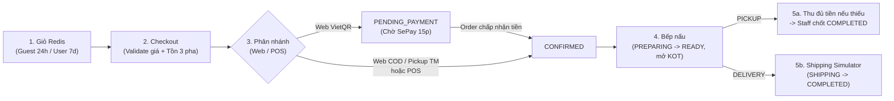

[← Mục lục tra cứu nhanh](./00-muc-luc.md)

# 01 — Khung thuyết trình & kịch bản bảo vệ (5–7 phút)

> **Trả lời nhanh 30 giây:** Em phụ trách phân hệ **M3 — Cart, Order & API Gateway** (cùng giao diện đặt hàng Customer Next.js, giao diện vận hành POS/Staff/Admin React và luồng thu tiền/hoàn tiền Sprint 3). Trọng tâm kiến trúc em bảo vệ là **tách đôi 2 trục trạng thái (tiến độ món vs dòng tiền)**, **chống đặt trùng/xung đột đồng thời bằng DB + khóa dòng + `@Version`**, **giỏ hàng Redis**, **thanh toán VietQR SePay đối soát 2 chiều**, và **hoàn tiền 2 pha có chứng từ bảo mật** kết nối qua **Kafka Outbox**.

---

## 1. Mở đầu & Bức tranh sản phẩm (30 giây)

- **Clucky** là nền tảng đặt đồ ăn nhanh chuỗi, phục vụ đồng thời **2 giao diện** (Website khách hàng Next.js 15 & Portal nhân viên/quản lý/admin React 19) dùng chung **12 module backend Java 21 / Spring Boot 3.4**.
- Một đơn hàng phải phục vụ nhiều tổ hợp thực tế tại quán F&B:
  - **Nguồn tạo (`orderSource`)**: Khách đặt online (`WEB`) hoặc Thu ngân tạo nhanh tại quầy POS (`COUNTER`).
  - **Cách nhận (`type` / `diningOption`)**: Giao tận nơi (`DELIVERY`), Tự đến lấy (`PICKUP` / `TAKE_AWAY`), hoặc Ăn tại quán (`DINE_IN`, cấp số gọi món `queueNumber` `1–999`).
  - **Cách trả (`paymentMethod`)**: Tiền mặt (`CASH` / `COD`), Chuyển khoản VietQR tự động SePay (`BANK_TRANSFER`), hoặc Kết hợp tiền mặt + VietQR tại quầy (`SPLIT`).

---

## 2. Phạm vi đóng góp cá nhân — Phân định rõ để tránh bị bắt bẻ (1 phút)

Khi trình bày với mentor, **nói rõ phần trực tiếp làm (M3 — Trần Đức Anh)** và **phần phối hợp API/Kafka với thành viên khác** (theo [`docs/TASKS-M3-TRAN-DUC-ANH.md`](file:///f:/OJT/Clucky/docs/TASKS-M3-TRAN-DUC-ANH.md) và [`docs/TASKS-SPRINT3-TRAN-DUC-ANH.md`](file:///f:/OJT/Clucky/docs/TASKS-SPRINT3-TRAN-DUC-ANH.md)):

| Nhóm công việc | Phần trực tiếp sở hữu & triển khai | Phần phối hợp liên service |
|---|---|---|
| **API Gateway & Điều phối** | Cấu hình định tuyến `api-gateway` (`lb://`), strip/inject identity header, kết nối qua Gateway duy nhất | Phối hợp `identity-service` kiểm tra Redis denylist JWT khi đăng xuất/thu hồi phiên |
| **Giỏ hàng & Checkout** | `CartService` (Redis Hash, TTL 24h/7d, merge guest→user), `OrderService.preview/createOrder`, idempotency Web/POS, giữ tồn 3 pha | Gọi REST sang `catalog-store-service` validate món/combo & `reserveStock`; gọi `promotion-loyalty-service` & `shipping-service` |
| **Vòng đời đơn & POS** | State Machine 2 trục (`status` vs `paymentStatus`), POS `createCounterOrder`, khóa đổi phương thức `claimCounterPayment`, `updateStatus`, Cancel/Reject/Reorder/Party | Nhận `payment.received` từ `payment-service`, nhận `shipping.*` từ `shipping-service` qua `ShippingOrderProjection` |
| **Thu tiền & Hoàn tiền (Sprint 3)** | `BE-80` Staff Workspace (auto-poll 5s, chuông báo, SLA >10p, POS F1, Bill K80/KOT) & `BE-81` Counter collection, `RefundRequestService` 2 pha | Phối hợp `payment-service` (SePay webhook, `refund_reservations`), `promotion-loyalty-service` (clawback điểm), `notification-service` |
| **Frontend Next.js & React** | Customer: Cart, Checkout, Order Tracking (poll 5s), History/Reorder, Party; Admin/Staff: `StaffOrdersPage`, `CounterOrderModal`, `CounterPaymentModal`, `RefundsPanel` | Tích hợp block VietQR, Mapbox/Tracking, QR Loyalty trong các màn hình |

> **Mẹo nói với mentor:** Không nhận vơ phần viết lõi của module bạn khác (ví dụ: thuật toán tính tuyến Mapbox trong `MockRouteProvider` hay OTP/Firebase trong `identity-service`), mà nói rõ *"Em thiết kế hợp đồng giao tiếp, phần gọi REST / nhận Kafka event và cập nhật trạng thái phía Order/UI"*.

---

## 3. Kể mạch luồng End-to-End (1.5 phút)

**5 câu kể trôi chảy theo sơ đồ:**
1. **Chọn món:** Khách thêm món vào giỏ lưu trên **Redis Hash** (Guest 24h, User 7 ngày; đăng nhập thì gộp giỏ).
2. **Đặt đơn:** Tại Checkout, Frontend không quyết định giá — `OrderService` gửi qua `catalog-store-service` kiểm món/combo/giờ bán, tính tổng lại bằng `BigDecimal`, so sánh `expectedTotal`, lưu nháp `PENDING_STOCK`, giữ tồn kho chi nhánh rồi mới chốt đơn.
3. **Phân nhánh vào bếp:** Web VietQR chờ tiền (`PENDING_PAYMENT`) rồi mới nấu; Web COD, Web tự lấy tiền mặt và đơn quầy POS vào thẳng `CONFIRMED` để ưu tiên làm món nhanh *(riêng POS chưa thu tiền được UI gom vào tab **Chờ tiền** để thu ngân dễ theo dõi)*.
4. **Chốt bàn giao:** Đơn tự lấy bắt buộc đạt `READY` **và** tiền là `PAID`/`COLLECTED` mới cho chốt `COMPLETED` (thiếu tiền backend trả `409`). Đơn giao hàng do `shipping-service` mô phỏng chạy `SHIPPING → COMPLETED`, cấm nhân viên chốt tay.
5. **Cuối ngày & Hoàn tiền:** Tiền mặt/chuyển khoản quầy tổng hợp tại Sổ quỹ (`getShiftSummary`); đơn chuyển khoản hủy trước khi nấu hoặc giao thất bại có quy trình hoàn tiền 2 pha kèm ảnh chứng từ bảo mật.

---

## 4. Phần tâm đắc — 4 bài toán kỹ thuật khó đã giải quyết (2 phút)

1. **Tách 2 trục trạng thái + Chốt chặn bàn giao (`Handover Gate`):**
   - Không nhồi mọi thứ vào 1 biến `status`. Tách `status` (tiến độ bếp) và `paymentStatus` (dòng tiền), cộng thêm `merchantPaymentStatus` cho tiền ứng shipper mô phỏng (`PAID_SIMULATED`) để tách bạch tiền giả lập với doanh thu thật.
2. **Phối hợp khóa đổi phương thức POS xuyên 2 service không deadlock (`claimCounterPayment`):**
   - Trước khi khóa dòng `Order` để đổi phương thức (`CASH` ↔ `BANK_TRANSFER` ↔ `SPLIT`), `OrderService` hỏi `payment-service` trước rồi mới `lockById`. Ngược lại, khi `payment-service` bắt đầu thu tiền hoặc mở QR, nó gọi `claimCounterPayment` khóa đúng dòng `Order` đó và bật cờ `counterPaymentStarted = true`. Hai thao tác đụng nhau → người tới sau bị chặn `409`.
3. **Thanh toán SePay 2 chiều & Hoàn tiền 2 pha chống gian lận:**
   - Thu ngân POS **bị chặn cứng** ở backend không cho tự bấm xác nhận chuyển khoản nếu chưa có webhook thật từ SePay.
   - Hoàn tiền tách rõ: `PENDING` → `APPROVED` (giữ tiền `HELD` ở `payment-service` qua Worker) → `PROCESSING` (khóa cho 1 quản lý + đóng băng STK) → tải ảnh chứng từ lên **Cloudinary private** → băm **SHA-256** làm bằng chứng bắt buộc ở DB constraint mới cho chốt `REFUNDED`.
4. **Combo Redis + Kafka Outbox đúng vai trò:**
   - Redis gánh dữ liệu nóng, ngắn hạn, cần TTL/nguyên tử (giỏ hàng, cache menu, số gọi món quầy, QR Loyalty 30s, danh sách đen thu hồi JWT).
   - PostgreSQL + **Transactional Outbox** + Kafka đảm bảo các giao dịch tiền bạc/tồn kho/hoàn tiền/điểm thưởng chạy bền vững xuyên service, có chống lặp (`ON CONFLICT DO NOTHING`) và DLT an toàn PII.

---

## 5. Năm đoạn code "vàng" mở ra chứng minh ngay khi Mentor hỏi

| # | Cần chứng minh điều gì? | Đường dẫn file (trong `f:\OJT\Clucky`) & Vị trí chính xác |
|---|---|---|
| 1 | **Thời hạn giỏ hàng Redis 24h / 7 ngày** | `backend/cart-order-service/src/main/java/com/clucky/cartorderservice/cart/CartService.java` — `GUEST_CART_TTL`, `CUSTOMER_CART_TTL` (dòng 21–22) |
| 2 | **Phân nhánh trạng thái ban đầu đơn Web (COD/0đ vs VietQR)** | `backend/cart-order-service/src/main/java/com/clucky/cartorderservice/service/OrderService.java` — `createOrder` / `initialStatus` (dòng 493–495) |
| 3 | **Chốt chặn bắt buộc `PAID`/`COLLECTED` trước khi `COMPLETED` (409)** | `backend/cart-order-service/src/main/java/com/clucky/cartorderservice/service/OrderService.java` — `updateStatus` (dòng 1200–1259, chốt tiền dòng 1229–1233) |
| 4 | **Khóa đổi phương thức POS khi đã bắt đầu thu (`counterPaymentStarted`)** | `backend/cart-order-service/src/main/java/com/clucky/cartorderservice/service/OrderService.java` (`changeCounterPaymentMethod`, dòng 1169–1193) & `OrderPaymentService.java` (`claimCounterPayment`, dòng 69) |
| 5 | **Tách hiển thị tiền ứng COD mô phỏng & Quy trình hoàn tiền 2 pha** | `frontend/react/src/lib/order-fulfillment.ts` (`displayPaymentStatus`, dòng 4–10) & `RefundRequestService.java` (`approveRefundRequest` dòng 234, `claimProcessing` dòng 262, `confirmRefund` dòng 366, `completeConfirmation` dòng 386) |
