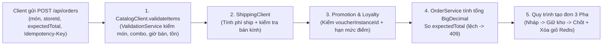

[← Mục lục tra cứu nhanh](./00-muc-luc.md)

# 03 — Giỏ hàng Redis (Vì sao chọn Redis?) & Luồng Checkout

> **Trả lời nhanh 30 giây:** Clucky lưu giỏ hàng bằng **Redis Hash** (`cart:guest:{sessionId}` hạn **24 giờ**, `cart:{userId}` hạn **7 ngày**) vì giỏ hàng là dữ liệu "nháp, đổi liên tục, tỷ lệ bỏ cao" nên cần đọc/ghi tốc độ RAM và tự dọn bằng TTL thay vì làm nghẽn PostgreSQL. Khi bấm Checkout, Backend **không tin giá hay trạng thái từ client** mà gọi `catalog-store-service` tính lại toàn bộ bằng `BigDecimal`, so sánh `expectedTotal` (lệch trả `409`), rồi giữ tồn kho theo **quy trình 3 pha (Nháp → Giữ kho REST → Chốt đơn Outbox)**.

---

## 1. Tại sao dùng Redis cho Giỏ hàng? (Câu hỏi Mentor rất hay xoáy!)

### Bảng so sánh 4 phương án lưu Giỏ hàng

| Tiêu chí | **Redis Hash (Clucky chọn)** | **PostgreSQL (DB chính)** | **LocalStorage trình duyệt** | **HTTP Session (Server RAM)** |
|---|---|---|---|---|
| **Tốc độ đọc/ghi** | Cực nhanh (**RAM**, dưới mili-giây) | Chậm hơn (ghi đĩa, tạo row rác, index bloat) | Nhanh ở máy khách, không chia sẻ qua API | Nhanh nhưng dính chặt 1 instance server |
| **Tải lên DB chính** | **Không tốn I/O của Postgres** cho hành động thêm/bớt thử món | Nặng (hàng nghìn lượt thêm/xóa nhưng khách không đặt) | Không tốn DB nhưng không kiểm soát được từ backend | Tốn RAM ứng dụng Java, khó scale ngang |
| **Khách chưa đăng nhập (Guest)** | Rất tốt (`cart:guest:{sessionId}`) | Khó quản lý user rác trong bảng quan hệ | Chỉ sống trên 1 trình duyệt duy nhất | Mất khi hết session hoặc restart container |
| **Đồng bộ đa thiết bị (User)** | Rất tốt (`cart:{userId}`, mở ĐT hay PC đều chung giỏ) | Tốt nhưng tốn query | **Thất bại** (đăng nhập máy khác là mất giỏ) | **Thất bại** (khác phiên là mất) |
| **Tự động dọn rác (TTL)** | **Có sẵn (`EXPIRE`)** — hết hạn tự xóa | Phải tự viết cron job `DELETE` định kỳ | Không có TTL chuẩn phía server | Khó cấu hình tách biệt Guest 24h vs User 7d |

### Cách giải thích gãy gọn cho Mentor hiểu ngay
1. **Giỏ hàng có vòng đời ngắn và tần suất ghi đột biến:** Khách bấm `+ / - / đổi topping` liên tục rồi bỏ giỏ rất nhiều. Đẩy hết sang Redis giúp PostgreSQL chỉ tập trung cho **giao dịch thật** (Đơn hàng, Thanh toán, Tồn kho).
2. **Hỗ trợ mượt chuyển tiếp Guest → Đăng nhập:** Khách chưa có tài khoản vẫn thêm món thoải mái qua `cart:guest:{sessionId}` (lưu session ID ở `localStorage`/`cookie`); lúc đăng nhập hệ thống gộp thẳng vào `cart:{userId}` bằng `mergeCart` rồi xóa giỏ guest.
3. **Dọn rác miễn phí bằng TTL:** Redis tự thu hồi giỏ quá 24h (Guest) hoặc 7 ngày (Customer) nhờ cơ chế hết hạn tự nhiên, không tốn batch job dọn bảng rác trong DB.

---

## 2. Tổ chức dữ liệu Giỏ hàng & Quy tắc TTL trong Clucky

### Cấu trúc Redis Hash (`CartService`, `CartController`, `CartItemDto`)

```text
Key:   cart:{userId}              (Customer đã đăng nhập — TTL 7 ngày)
  hoặc cart:guest:{sessionId}     (Khách vãng lai — TTL 24 giờ)

Field (itemKey): MD5("P:12|opt:1,3|top:5")   hoặc   MD5("C:2|combo:10:opt:2:top:|...")
Value (JSON):    { "productId": 12, "quantity": 2, "unitPrice": 55000, "note": "...", ... }
```

- **Cách nhận diện Guest (`CartController.resolveContext`):** Ưu tiên theo thứ tự: header `X-Guest-Session-Id` → cookie `clucky_guest_session` → HTTP session có sẵn → sinh UUID mới. `STAFF`/`ADMIN` gọi API giỏ khách bị chặn theo vai trò.
- **Cách gộp món trùng (`CartItemDto.generateItemKey`, L59–83):**
  - Băm **MD5 hex** tổ hợp: loại (`P:` hoặc `C:`) + ID + `optionIds` đã sắp xếp + `toppingIds` đã sắp xếp + `comboSelections` đã sắp xếp.
  - **Không đưa vào `itemKey`:** `quantity`, `note`, `storeId`, `unitPrice`, `expectedVersion`.
  - Do đó, thêm cùng món & cùng cấu hình option/topping/combo → **tự động cộng dồn `quantity`** trên cùng 1 field thay vì tạo 2 dòng giống nhau.

### Bảng quy tắc đặt lại TTL (Sliding Expiration — cực kỳ hay bị hỏi!)

| Thao tác trên giỏ | Hành vi TTL thực tế trong `CartService.java` |
|---|---|
| `addItem` (thêm mới hoặc cộng món trùng) | `HSET` xong → **Đặt lại TTL** (24h Guest / 7d User) |
| `updateItemQuantity` / `updateItem` (số lượng > 0) | Lưu xong → **Đặt lại TTL** |
| `mergeCart` (đăng nhập gộp giỏ guest) | Ghi giỏ đích → **Đặt lại TTL 7 ngày**, sau đó `DEL` giỏ guest |
| **`getCart` (chỉ mở xem giỏ)** | **KHÔNG gia hạn TTL** (giữ nguyên hạn cũ) |
| **`removeItem` (hoặc sửa số lượng <= 0)** | Chỉ xóa field (`HDEL`), **KHÔNG gia hạn TTL** |

> **Ví dụ kể với Mentor cho dễ nhớ:** Khách vãng lai thêm món lúc **10h sáng Thứ Hai** → hạn là **10h sáng Thứ Ba**. Nếu 9h sáng Thứ Ba khách chỉ mở xem lại (`getCart`) → **vẫn hết hạn lúc 10h Thứ Ba**. Nếu lúc 9h khách tăng số lượng lên 2 (`updateItem`) → hạn được kéo dài tới **9h sáng Thứ Tư**. Đóng trình duyệt không làm dừng đồng hồ TTL.

### Cấu hình hạ tầng Redis trong `deploy/backend/compose.yml`
- Chạy `redis:7-alpine` với `--appendonly yes` (bật AOF lưu đĩa để khởi động lại không mất giỏ còn hạn), `--maxmemory 192mb`, `--maxmemory-policy noeviction`.
- **Tại sao chọn `noeviction` thay vì `allkeys-lru`?** Vì Redis này dùng chung cho cả **danh sách đen thu hồi JWT (`auth:revoked:*`)**. Nếu dùng LRU, khi đầy RAM Redis có thể tự xóa nhầm marker thu hồi token khiến người đã đăng xuất dùng lại được JWT cũ → `noeviction` giúp bảo mật **fail-closed** (an toàn tuyệt đối cho auth).

---

## 3. Ba giới hạn kỹ thuật của Giỏ Redis (Nói thẳng nếu Mentor hỏi sâu)

1. **Read-Modify-Write chưa dùng Lua Transaction:** Các hàm `addItem`, `updateItem`, `mergeCart` trong `CartService` đọc hash lên JVM rồi ghi lại nhiều lệnh riêng lẻ (chưa bọc Lua script hay `WATCH/MULTI`). Phía trình duyệt có dùng `navigator.locks` lúc merge khi login, nhưng 2 request song song từ ngoài vẫn có rủi ro mất cập nhật nếu bấm sát nhau.
2. **Hằng số TTL hardcode:** `CartService.java` (L21–22) dùng hằng `GUEST_CART_TTL = Duration.ofHours(24)` và `CUSTOMER_CART_TTL = Duration.ofDays(7)` thay vì đọc `RedisConfig.Policy` (`clucky.redis.ttl.*` trong `config-repo/application.yml`). *(Sửa config YAML hiện chưa tự đổi TTL của `CartService`)*.
3. **Giỏ chưa giữ tồn & chưa khóa giá:** Thêm vào giỏ chỉ là ý định mua. Tồn kho và giá chỉ được xác minh lại khi Preview và Checkout.

---

## 4. Luồng Checkout & Xác minh giá Server-Side



### Nguyên tắc tính tiền bất biến (`OrderService.createOrder`, L429–484)
- **Giá lấy từ `catalog-store-service`:** `ValidationService.validateOrderItems()` tính lại từng món, topping, và bung từng **Combo** ra giá combo + `extraPrice` + danh sách `stockQuantities` các sản phẩm thành phần cần trừ kho.
- **Công thức ưu đãi chặt chẽ:**
  1. `merchandiseAfterVoucher = max(subtotal - voucherDiscount, 0)`
  2. `discountAmount = voucherDiscount + tierDiscount` (hạng thành viên)
  3. Điểm thưởng (`pointsAmount`) chỉ được trừ tối đa bằng phần tiền món còn lại (`merchandiseRemaining`), **TUYỆT ĐỐI KHÔNG bao giờ trừ vào `shippingFee`**.
  4. `totalAmount = max(subtotal - discountAmount - pointsAmount, 0) + shippingFee`.
- **Chống lệch giá (`409 RESOURCE_CONFLICT`):** Nếu trong lúc khách mở màn checkout mà Admin đổi giá món/hết khuyến mãi khiến `totalAmount != request.expectedTotal` → backend từ chối ngay với `409` để UI tải lại giá mới.
- **Web chặn nhập mã voucher gõ tay:** Checkout web dùng `voucherInstanceId` (voucher đã lưu trong ví khách), từ chối kiểu nhập mã tự do.

---

## 5. Quy trình Tạo đơn & Giữ tồn kho 3 Pha (Saga + Bồi hoàn)

Tại sao không mở `@Transactional` giữ lock DB Order trong lúc gọi mạng sang `catalog-store-service`? Vì gọi REST qua mạng mà giữ transaction DB sẽ gây treo connection pool và dễ deadlock! Clucky tách làm **3 Pha** (`OrderService.createOrder`, L503–703):

| Pha | Thực hiện ở đâu | Chi tiết kỹ thuật & Xử lý khi lỗi |
|---|---|---|
| **Pha 1: Lưu nháp** | DB Transaction 1 (`order_service`) | Claim `Idempotency-Key` vào `web_order_operations` (hoặc `counter_order_operations`), tạo bản ghi `Order` ở trạng thái **`PENDING_STOCK`**, gắn `order_id` vào bảng claim. |
| **Pha 2: Giữ tồn kho** | **Ngoài DB Transaction** (REST đồng bộ) | Gọi `POST /api/catalog/internal/reserve-stock` (`OrderStockService.reserveOrderStock`).<br>• Tạo/khóa `catalog_service.order_stock_ledger(order_id)` chống trừ lặp.<br>• Sắp xếp `productId` bằng **`TreeMap`** trước khi khóa `StoreInventory` (`PESSIMISTIC_WRITE`) để **chống Deadlock**.<br>• Kiểm tra `@Version` & tồn đủ. Nếu thiếu hàng → hủy transaction Catalog, Order chuyển nháp thành `CANCELLED` + xóa claim để retry. |
| **Pha 3: Chốt đơn & Bù lỗi** | DB Transaction 2 (`order_service`) | Khóa dòng nháp `PENDING_STOCK` → gọi `loyaltyClient` giữ voucher/điểm → lưu `order_items` (kèm snapshot combo/topping cho bếp KOT) → đổi `status` sang `PENDING_PAYMENT` hoặc `CONFIRMED` → ghi `order.created` vào **Outbox** → **xóa giỏ hàng Redis**.<br>**Nếu Pha 3 lỗi:** rollback DB Order → gọi đồng bộ `releaseStock` (retry 3 lần) → mở tx `REQUIRES_NEW` hủy nháp + phát `order.cancelled`. |

### Lưới an toàn nếu sập nguồn giữa Pha 2 và Pha 3
- **`PendingStockRecoveryScheduler`** (`cart-order-service`, chạy mỗi **60 giây**): tự động hủy các đơn nháp `PENDING_STOCK` bị treo quá **15 phút**, phát `order.cancelled` và dọn claim mồ côi.
- **`StockReconciliationScheduler`** (`catalog-store-service`, chạy mỗi **60 giây**): rà các dòng ledger `sync-reserve-%` vẫn ở trạng thái `DEDUCTED` quá **10 phút**, hỏi lại `cart-order-service`; nếu đơn không tồn tại (`404`) hoặc đã `CANCELLED` thì tự động hoàn trả tồn kho.

---

## File code mở chứng minh ngay
- Giỏ hàng Redis & TTL: `backend/cart-order-service/src/main/java/com/clucky/cartorderservice/cart/CartService.java` (L21–22), `CartController.java`, `CartItemDto.java` (L59–83)
- Checkout & 3 pha giữ tồn: `backend/cart-order-service/src/main/java/com/clucky/cartorderservice/service/OrderService.java` (`createOrder` L429–703, `cancelPendingStockDraft` L1061–1084)
- Validate món/combo & Giữ kho chống deadlock: `backend/catalog-store-service/src/main/java/com/clucky/catalogstoreservice/service/ValidationService.java`, `OrderStockService.java` (L71–149), `InventoryService.java` (L145–178)
- Cấu hình Redis: `deploy/backend/compose.yml` (L63–75), `config-repo/application.yml` (L61–68)
