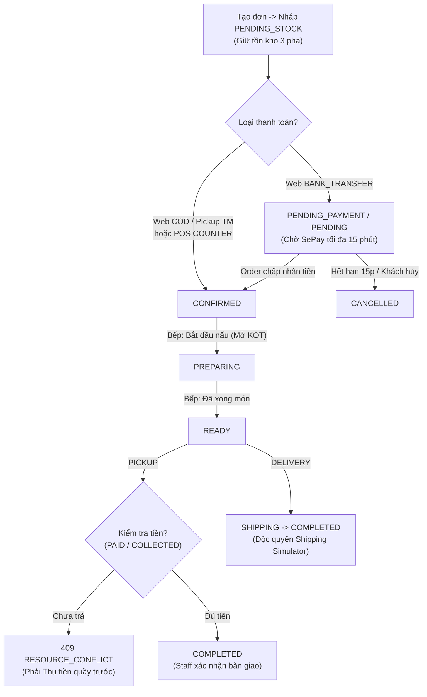

[← Mục lục tra cứu nhanh](./00-muc-luc.md)

# 04 — State Machine 2 Trục, Ma trận 4 Chiều & Vận hành POS

> **Trả lời nhanh 30 giây:** Clucky **tách đôi** trạng thái đơn hàng thành 2 trục độc lập: **Tiến độ món (`Order.status`)** và **Dòng tiền (`Order.paymentStatus`)**, cộng thêm **trục tiền ứng mô phỏng (`merchantPaymentStatus`)** cho đơn giao COD. Nhờ đó bếp có thể nấu trước (đơn POS, COD, tự lấy tiền mặt), nhưng **tại chốt bàn giao (`COMPLETED`) bắt buộc tiền phải là `PAID` hoặc `COLLECTED`**, nếu thiếu backend trả `409`.

---

## 1. Triết lý cốt lõi: Tách đôi 2 trục trạng thái

Nếu gộp tiến độ nấu và tiền bạc vào chung một biến `status`, hệ thống sẽ bế tắc với các ca thực tế như *"khách đặt tại quầy ăn trước trả sau"* hoặc *"shipper giao COD xong nhưng kế toán chưa coi là tiền đã thanh toán qua ngân hàng"*.

Clucky dùng **3 trường độc lập** trên `Order`:
1. **Trục Tiến độ món (`status` — 9 enum `OrderStatus`):**
   `PENDING_STOCK` → `PENDING_PAYMENT` / `CONFIRMED` → `PREPARING` → `READY` → `SHIPPING` → `COMPLETED` *(hoặc `CANCELLED`, `DELIVERY_FAILED`)*.
2. **Trục Dòng tiền thật (`paymentStatus`):**
   `PENDING` → `PAID` *(ngân hàng đối soát xong)* hoặc `COLLECTED` *(tiền mặt vào két / kết hợp xong / miễn trả 0đ)* → `REFUNDED` *(khi hoàn tiền xong)*.
3. **Trục Tiền ứng mô phỏng (`merchantPaymentStatus` — dành riêng giao COD):**
   `PAID_SIMULATED` *(shipper giả lập ứng tiền cho quán)* hoặc `ADVANCE_RETURNED` *(trả món về quán)* — giữ `paymentStatus = PENDING` để không làm sai sổ kế toán thật.

> **Quy tắc vàng:** *Nấu có thể đi trước thu (tùy kênh), nhưng **Bàn giao (`COMPLETED`) của đơn tự lấy (`PICKUP`)** luôn phải chờ tiền đã vào sổ (`PAID` hoặc `COLLECTED`).*

---

## 2. Ma trận 4 chiều & Bảng trạng thái 7 nhánh + Đơn 0đ

Mọi đơn hàng được phân nhánh dựa trên 4 chiều: **`orderSource`** (`WEB` / `COUNTER`) × **`type` / `diningOption`** (`DELIVERY` / `PICKUP` / `TAKE_AWAY` / `DINE_IN`) × **`paymentMethod`** (`COD` / `CASH` / `BANK_TRANSFER` / `SPLIT`) × **Thẩm quyền Actor** (Staff chỉ chuyển bếp & bàn giao `PICKUP`; Simulator chuyển `SHIPPING`/`COMPLETED` đơn `DELIVERY`; SePay/Payment chốt `PAID`).

*(Ghi chú: sau bước nháp `PENDING_STOCK` và giữ kho thành công, trạng thái khởi tạo như bảng sau:)*

| # | Nhánh đơn hàng | Ban đầu (`status / paymentStatus`) | Đường đi tiếp theo |
|---|---|---|---|
| 1 | **Web Giao hàng + VietQR** | `PENDING_PAYMENT / PENDING` | Chờ tiền tối đa 15p → SePay khớp → `CONFIRMED / PAID` → Bếp `PREPARING` → `READY` → Simulator `SHIPPING → COMPLETED` |
| 2 | **Web Tự lấy + VietQR** | `PENDING_PAYMENT / PENDING` | Chờ tiền 15p → SePay khớp → `CONFIRMED / PAID` → Bếp `PREPARING` → `READY` → Staff xác nhận khách nhận `COMPLETED` |
| 3 | **Web Giao hàng + COD** | `CONFIRMED / PENDING` | Nấu trước → `READY` → Shipper giả lập nhận món (`merchantPaymentStatus = PAID_SIMULATED`) → `SHIPPING → COMPLETED` *(vẫn `PENDING`)* |
| 4 | **Web Tự lấy + Tiền mặt** *(mã `COD`)* | `CONFIRMED / PENDING` | Nấu trước → `READY` → Upload ảnh bằng chứng + Thu tiền quầy (`COLLECTED`) → Staff chốt `COMPLETED` |
| 5 | **POS Quầy + Tiền mặt (`CASH`)** | `CONFIRMED / PENDING` | UI gom vào tab **Chờ tiền** *(trừ khi thu ngay lúc tạo)*. Thu xong → `COLLECTED`, về nhóm tiến độ → Bếp → `COMPLETED` |
| 6 | **POS Quầy + VietQR (`BANK_TRANSFER`)** | `CONFIRMED / PENDING` | UI gom **Chờ tiền**, mở phiên QR POS. SePay webhook thật → `PAID` → Bếp → `COMPLETED` |
| 7 | **POS Quầy + Kết hợp (`SPLIT`)** | `CONFIRMED / PENDING` | Khóa phần tiền mặt + mở QR phần còn lại. SePay webhook khớp → `COLLECTED` (`collectionMethod = MIXED`) |
| 8 | **Đơn 0đ** *(do voucher/điểm)* | `CONFIRMED / COLLECTED` | Tự gán `collectionMethod = NO_PAYMENT`, bỏ qua bước thu tiền |

---

## 3. Sơ đồ vòng đời & Phân biệt 2 tầng ở POS

### Điểm bẫy hay bị hỏi: "Tại sao POS nằm ở tab `Chờ tiền` nhưng DB lại ghi `CONFIRMED`?"
- **Tầng Backend (`OrderService.createCounterOrder`):** Mọi đơn POS mới tạo đều khởi tạo `status = CONFIRMED` và `paymentStatus = PENDING`, đồng thời backend **vẫn cho phép** `CONFIRMED → PREPARING` theo bảng chuyển trạng thái.
- **Tầng Giao diện (`StaffOrdersPage.tsx` — `queueCounts` / `visibleOrders`):** UI chủ động **gom** các đơn `COUNTER` còn `paymentStatus = PENDING` (bất kể `status` đang là `CONFIRMED`, `PREPARING` hay `READY`) vào tab **"Chờ tiền"** để thu ngân không sót tiền khi khách chưa trả.
- **Cách trả lời chuẩn cho Mentor:** *"Tab Chờ tiền là phép phân loại giao diện theo trạng thái tiền của đơn POS, không đồng nghĩa `Order.status = PENDING_PAYMENT`. Khi thu ngân thu xong, đơn tự động quay về đúng tab tiến độ bếp hiện tại."*

---

## 4. Khóa đổi phương thức thanh toán POS (`claimCounterPayment`)

Trên POS, trước khi thu tiền, thu ngân có thể đổi giữa `CASH` ↔ `BANK_TRANSFER` ↔ `SPLIT` (`PUT /api/orders/{id}/counter/payment-method` kèm `version`). Tuy nhiên, nếu Thu ngân A đang bấm đổi phương thức mà Thu ngân B hoặc một tab khác vừa mở mã QR / thu tiền mặt thì sao?

**Giải pháp phối hợp 2 chiều không Deadlock:**
1. **`OrderService.changeCounterPaymentMethod()` (L1169–1193):**
   - **Trước khi khóa DB Order**, gọi REST `GET /api/payments/internal/orders/{id}/counter-activity` hỏi `payment-service` xem đơn đã có phiên QR, biên lai không `VOIDED`, hay collection nào chưa *(cố tình gọi ngoài lock Order để tránh deadlock chéo service)*.
   - Sau đó mới khóa dòng Order bằng `PESSIMISTIC_WRITE`, kiểm tra `version`, và chặn **`409 RESOURCE_CONFLICT`** nếu `order.isCounterPaymentStarted() || existingPaymentActivity`.
2. **`OrderPaymentService.claimCounterPayment()` (L69):**
   - Khi `payment-service` chuẩn bị tạo phiên QR POS hoặc tạo collection tiền mặt, nó gọi `POST /api/orders/{id}/counter-payment-claim`.
   - Hàm này khóa đúng dòng Order bằng `lockById` (`PESSIMISTIC_WRITE`), đối chiếu `storeId`/`orderCode`/`paymentMethod`/`totalAmount`, và bật cờ **`counter_payment_started = true`** (`V25`).
   - **Kết quả:** Ai lấy được khóa dòng Order trước thì thắng, người còn lại bị `409` ngay lập tức.

---

## 5. Chốt chặn bảo vệ trong `OrderService.updateStatus` (L1200–1259)

| Quy tắc bảo vệ | Hành vi Backend khi vi phạm |
|---|---|
| **Cấm sửa tiền qua API trạng thái** | Request truyền `paymentStatus != null` → `400 VALIDATION_ERROR` |
| **Cấm hủy khi đã vào bếp** | `PREPARING` hoặc `READY` mà gửi `CANCELLED` (hoặc gọi `/cancel`, `/reject`) → `409 RESOURCE_CONFLICT` (*"Không thể hủy đơn hàng đã chế biến"*) |
| **Cấm nhân viên chốt tay đơn giao hàng** | Đơn `DELIVERY` gửi `SHIPPING`, `COMPLETED`, `DELIVERY_FAILED` qua API nhân viên → `409 RESOURCE_CONFLICT` |
| **Chốt bàn giao `PICKUP`** | Gửi `COMPLETED` khi chưa `READY`, hoặc `type != PICKUP`, hoặc `paymentStatus` không thuộc `{PAID, COLLECTED}` → `409 RESOURCE_CONFLICT` |
| **Chống ghi đè đồng thời** | Nếu client gửi `version` khác `order.getVersion()` (`@Version`) → `409 RESOURCE_CONFLICT` |

---

## 6. Ba Đơn mẫu chuẩn (Dùng minh họa khi Demo hoặc Vấn đáp)

- **Đơn mẫu A — Web Giao tận nơi + VietQR:** Tạo đơn ra `PENDING_PAYMENT / PENDING` → Chờ SePay webhook → `CONFIRMED / PAID` → Bếp `PREPARING → READY` → `MockDeliveryEngine` chạy `SHIPPING → COMPLETED`. *(Chứng minh tiền trước bếp & tách quyền Delivery).*
- **Đơn mẫu B — Web Tự lấy + Tiền mặt:** Tạo đơn ra `CONFIRMED / PENDING` → Nấu trước `PREPARING → READY` → Thử bấm hoàn tất bị **`409`** → Upload ảnh bằng chứng + Thu tiền quầy (`COLLECTED`) → Bấm xác nhận khách nhận thành công `COMPLETED`. *(Chứng minh chốt Handover Gate).*
- **Đơn mẫu C — POS Quầy + Đổi phương thức:** Tạo nhanh F1 (`CASH`, chưa thu) ra `CONFIRMED / PENDING` (nằm tab **Chờ tiền**, có `queueNumber` `1–999` qua Redis `INCR` `queue:store:{storeId}:{yyyyMMdd}`) → Đổi sang `BANK_TRANSFER` thành công → Mở phiên QR POS (`claimCounterPayment`) → Thử đổi lại phương thức bị **`409`** → SePay webhook thật → `PAID` → Quay về tab tiến độ & mở Bill K80 / Phiếu bếp KOT mô phỏng.

---

## File code mở chứng minh ngay
- Tạo đơn, đổi phương thức POS, chốt trạng thái, sinh số gọi món: `backend/cart-order-service/src/main/java/com/clucky/cartorderservice/service/OrderService.java` (L493–495, L1169–1259, L1655–1683)
- Claim khóa phương thức từ Payment: `backend/cart-order-service/src/main/java/com/clucky/cartorderservice/service/OrderPaymentService.java` (L69)
- UI gom tab Chờ tiền, POS & Bill K80/KOT: `frontend/react/src/pages/Staff/StaffOrdersPage.tsx`, `CounterOrderModal.tsx`, `CounterPaymentModal.tsx`, `ReceiptBillModal.tsx`
- Migration claim POS & version: `backend/cart-order-service/src/main/resources/db/migration/V16__add_order_version.sql`, `V25__counter_payment_claim.sql`
