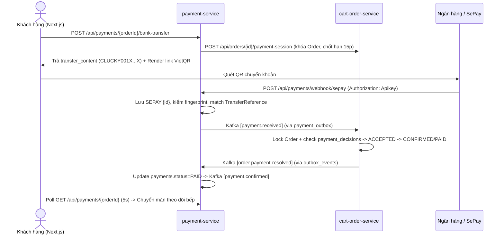

[← Mục lục tra cứu nhanh](./00-muc-luc.md)

# 05 — Thanh toán VietQR SePay, Thu tiền POS & Đối soát

> **Trả lời nhanh 30 giây:** Thanh toán chuyển khoản dùng chuẩn **VietQR + SePay Webhook** theo mô hình **đối soát 2 chiều qua Kafka**: `payment-service` không tự chốt đơn mà chỉ xác thực webhook (bằng **`MessageDigest.isEqual`** chống timing attack, chống lặp bằng `SEPAY:{id}` + SHA-256 `webhook_fingerprint`) rồi đề xuất sự kiện `payment.received`; **`cart-order-service`** là nơi quyết định cuối cùng (`ACCEPTED`/`EXPIRED`/`CANCELLED`) và phản hồi lại `order.payment-resolved`. Tại quầy POS, thu ngân **bị chặn cứng** không thể tự bấm xác nhận chuyển khoản nếu thiếu webhook thật.

---

## Phần A — Thanh toán Online VietQR + SePay

### 1. Sơ đồ luồng 2 chiều (`sequenceDiagram`)

### 2. Năm kỹ thuật bảo vệ luồng VietQR SePay (Giải thích cho Mentor)

1. **Khởi tạo phiên duy nhất & cố định hạn 15 phút (`PaymentFlow.initialize`):**
   - Dùng khóa tư vấn Postgres `pg_advisory_xact_lock(hashtextextended('payment-order:' || orderId, 0))` kết hợp **partial unique index** `one_live_payment_per_order(order_id) WHERE live_payment` (`V7`) → bảo đảm 1 đơn hàng tại 1 thời điểm chỉ có tối đa 1 phiên QR sống.
   - Gọi `OrderPaymentService.open` khóa dòng Order và chốt `payment_expires_at = now() + 15m` (`payment.session-ttl: 15m`). `OrderPaymentWorker.expire()` chạy mỗi **5 giây** sẽ tự động hủy các đơn `PENDING_PAYMENT` quá hạn (`SYSTEM_SAGA`, `PAYMENT_EXPIRED`) và phát `order.cancelled`.
2. **Mã tham chiếu chuyển khoản chống nhầm lẫn (`TransferReference`):**
   - Sinh mã dạng `CLUCKY` + `storeId` (>=3 chữ số) + `X` + 8 ký tự hex + `X` (ví dụ `CLUCKY001XA1B2C3D4X`).
   - Khi đọc nội dung chuyển khoản từ ngân hàng, chuẩn hóa bỏ dấu tiếng Việt (NFD), viết hoa, bỏ ký tự đặc biệt rồi mới match regex; bắt được ngay các ca: chứa nhiều mã (`AMBIGUOUS_REFERENCE`), sai đầu mã cửa hàng (`STORE_REFERENCE_CONFLICT`), sai số tài khoản chi nhánh (`BANK_ACCOUNT_MISMATCH`), hoặc có `subAccount` lạ (`SUB_ACCOUNT_REVIEW`).
3. **Bảo mật Webhook chống giả mạo & Timing Attack (`SepayWebhookSecurity`):**
   - Bộ lọc riêng `@Order(1)` trên `POST /api/payments/webhook/sepay`.
   - So sánh header `Authorization: Apikey <key>` bằng **`MessageDigest.isEqual(...)`** (so sánh hằng số thời gian, chống Timing Attack). Nếu chưa cấu hình key hoặc dùng placeholder → trả `503`.
   - Giới hạn body tối đa **32 KB** (`413 PAYLOAD_TOO_LARGE`) và parse JSON chế độ strict (cấm key trùng lặp, kiểm tra số tiền nguyên `1..999,999,999,999`, ngày giờ đúng chuẩn `Asia/Ho_Chi_Minh`).
4. **Chống xử lý lặp & Phát hiện sửa đổi payload (`SepayReceiptService.receive`):**
   - Tạo khóa duy nhất `bank_tx_id = "SEPAY:" + id` và mã băm SHA-256 `webhook_fingerprint` của toàn bộ thông tin tài chính giao dịch.
   - Nếu SePay retry đúng cùng dữ liệu → chỉ tăng `replay_count` (idempotent, không cộng tiền 2 lần).
   - Nếu trùng `SEPAY:{id}` nhưng **lệch số tiền / nội dung / tài khoản** → ghi nhận vào bảng `payment_service.sepay_receipt_conflicts` (`DUPLICATE_CONTENT_MISMATCH`), reset `conflict_reviewed = false`, trả `409 RESOURCE_CONFLICT` và chặn tự động đối soát.
5. **Đối soát 2 chiều — Order là Nguồn chân lý duy nhất (SSOT):**
   - `PaymentFlow.reconcile` cộng dồn các giao dịch hợp lệ vào `received_amount`. Chỉ khi `received >= amount` và đơn chưa đóng mới đẩy `payment.received` vào `payment_service.payment_outbox`.
   - `OrderPaymentService.decide` khóa dòng Order, chống lặp qua `order_service.payment_decisions(payment_id PK)`, kiểm tra tổng tiền, chi nhánh và hạn dùng rồi mới quyết định `ACCEPTED` (hoặc `EXPIRED`/`CANCELLED`/`SUPERSEDED`), phát ngược `order.payment-resolved` về `payment-service`.

---

## Phần B — Thu tiền tại quầy POS, Web Pickup & Sổ quỹ

### 1. Ba hình thức thu tại quầy & Chống gian lận ảnh chuyển khoản

| Hình thức | Cơ chế xử lý thực tế trong code | Bảo vệ dòng tiền |
|---|---|---|
| **Tiền mặt POS (`CASH`)** | `POST /api/payments/counter-collection` (`CounterPaymentService.collect`): làm tròn tiền mặt tới bội số **1.000đ** (`RoundingMode.HALF_UP`), lưu `rounding_difference` & `cash_change`, tạo biên lai `counter_payment_receipts` (`REC-...`), đẩy `payment.received` (`operationType=COLLECTION`) để Order chuyển `COLLECTED`. | Hỗ trợ `POST /receipts/{id}/void` hủy biên lai thu nhầm (chỉ cho void khi chưa gắn `bank_tx_id` và collection bị từ chối / đơn còn `PENDING`). |
| **VietQR POS (`BANK_TRANSFER`) & Kết hợp (`SPLIT`)** | Mở phiên qua `POST /api/payments/{orderId}/counter-bank-transfer` (`PaymentFlow.initializeCounter`, yêu cầu `SEPAY_POS_ENABLED=true`, `amount = total - cashAmount`). `SPLIT` chốt `paymentStatus = COLLECTED` (`collectionMethod = MIXED`); `BANK_TRANSFER` chốt `PAID`. | **Chặn cứng thu ngân tự bấm xác nhận chuyển khoản POS** ở 4 nơi (`CounterPaymentService`, `PaymentOperations` x2, `OrderPaymentService`). Bắt buộc phải có webhook SePay thật! |
| **Web Tự lấy Tiền mặt (`WEB + PICKUP + COD`)** | Khách đặt online không quét QR. Khi tới quán nhận món, nhân viên thu tiền qua `PaymentOperations.collect` (`POST /api/payments/{orderId}/operations/collection`). | Bắt buộc phải upload ảnh bằng chứng vào `cod_collection_evidence` (kiểm magic bytes JPEG/PNG/WEBP, `<= 2 MiB`, lưu SHA-256). |

*(Lưu ý: Web giao tận nơi `DELIVERY + COD` bị chặn không cho thu qua API quầy; tiền ứng mô phỏng của shipper do `ShippingOrderProjection` ghi riêng vào `merchantPaymentStatus = PAID_SIMULATED`).*

### 2. Sổ quỹ & Két ca trực (`CounterPaymentService.getShiftSummary`)

- Màn hình `IncomingTransfersPage.tsx` (`/admin/transfers`) gọi `GET /api/payments/shift-summary?storeId=...&date=YYYY-MM-DD` (lấy `storeId` từ token với Staff/Manager, ngày theo `Asia/Ho_Chi_Minh`).
- Tổng hợp từ **3 nguồn** (biên lai `counter_payment_receipts`, phiên `payments` live đã trả/tiền mặt POS, và `collections` độc lập không gắn biên lai) để tính:
  - `totalCashCollected`, `totalCashChangeGiven`, `netCashInDrawer`
  - `totalBankReconciled`, `totalBankPending`, `totalDiscrepancy`
- **Điểm cần thành thật với Mentor:** Hiện tại `getShiftSummary` tổng hợp theo **ngày + chi nhánh**, chưa gắn `shiftId` đóng/mở ca của `identity-service` và chưa có số dư đầu ca. Đơn tạo hôm qua nhưng hôm nay mới thu tiền thì ngày tạo đơn (bên Orders) và ngày thu tiền (bên Sổ quỹ) có thể khác nhau.

---

## Phần C — Xử lý 5 tình huống ngoại lệ dòng tiền (Rất hay bị hỏi!)

| Tình huống ngoại lệ | Cách Clucky xử lý & Lý giải cho Mentor |
|---|---|
| **1. Khách chuyển THIẾU tiền** | `PaymentFlow.reconcile` cộng vào `received_amount` nhưng **chưa phát** `payment.received`. `missingAmount = max(amount - received, 0)`. Nếu phiên chưa hết hạn 15p, UI khách (`LiveOrderPayment`) tự vẽ lại QR với đúng số tiền còn thiếu `missingAmount` để khách chuyển bù. |
| **2. Khách chuyển DƯ tiền** | Hệ thống chấp nhận thanh toán đủ (`received >= amount`), tính `excessAmount = received - amount` để hiện cảnh báo. **Quan trọng:** Tiền chuyển dư **không** làm tăng giá trị đơn và **bị loại trừ khỏi số tiền hoàn tự động** trong `PaymentRefundService.getEligibleRefund`. |
| **3. Giao dịch chưa đối soát (`UNMATCHED`)** | Lưu ở `bank_transactions` kèm lý do (`REFERENCE_NOT_FOUND`, `BANK_ACCOUNT_MISMATCH`, `AMBIGUOUS_REFERENCE`...). `PaymentWorker.reconcile` chạy lại `recover()` mỗi 2 giây; hoặc Admin vào `FinanceDrawer` dùng `assign` / `reconcile` (yêu cầu `Idempotency-Key`, optimistic `version` và ghi `audit.recorded`) để gán thủ công vào đơn. |
| **4. Tiền đến MUỘN sau khi hết hạn 15p / đã hủy** | `PaymentFlow.reconcile` đánh dấu giao dịch là `LATE_RECEIPT` (`reason = ORDER_CLOSED`), **không phát `payment.received`** và không bao giờ tự động mở lại đơn đã đóng. Nếu `payment.received` vừa gửi đi đúng lúc worker hết hạn, `OrderPaymentService` trả quyết định `EXPIRED` và `PaymentFlow` giữ nguyên đóng phiên. |
| **5. Sai lệch nội dung / số tiền trên cùng mã SePay** | Ghi `sepay_receipt_conflicts` (`DUPLICATE_CONTENT_MISMATCH`), tăng `conflict_count`, ẩn khỏi tự động đối soát cho tới khi Admin rà soát thủ công. |

---

## File code mở chứng minh ngay
- Luồng VietQR, đối soát & ngoại lệ: `backend/payment-service/src/main/java/com/clucky/paymentservice/service/PaymentFlow.java`, `SepayReceiptService.java`, `TransferReference.java`
- Bảo mật Webhook Apikey: `backend/payment-service/src/main/java/com/clucky/paymentservice/config/SepayWebhookSecurity.java`
- Thu tiền quầy, làm tròn 1.000đ, Sổ quỹ: `backend/payment-service/src/main/java/com/clucky/paymentservice/service/CounterPaymentService.java`, `PaymentOperations.java`
- Quyết định phía Order & hết hạn 15p: `backend/cart-order-service/src/main/java/com/clucky/cartorderservice/service/OrderPaymentService.java`, `OrderPaymentWorker.java`
- Giao diện VietQR & Sổ quỹ: `frontend/nextjs/components/payment/live-order-payment.tsx`, `frontend/react/src/pages/Staff/IncomingTransfersPage.tsx`
