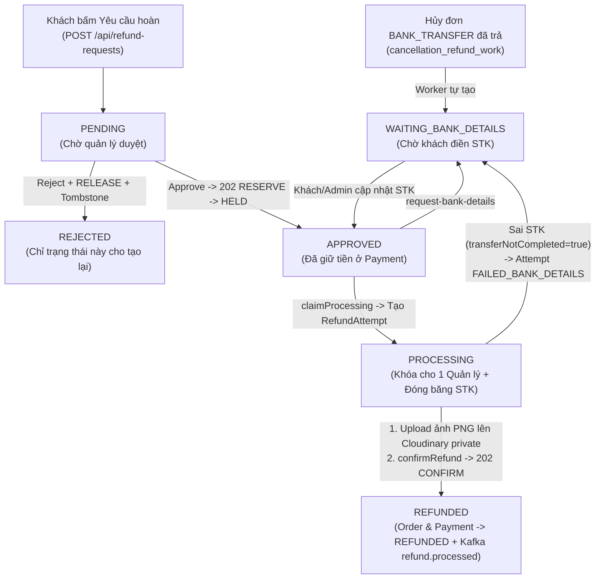

[← Mục lục tra cứu nhanh](./00-muc-luc.md)

# 06 — Logic Hoàn tiền (Refund) & Phương pháp đảm bảo nhất quán

> **Trả lời nhanh 30 giây:** Clucky hoàn tiền theo cơ chế **chuyển khoản thủ công ngoài hệ thống (không gọi API chi hộ ngân hàng)**, hoàn **100% giá trị đơn** (không hoàn phần chuyển dư) và **tách biệt chặt chẽ giữa "Duyệt (`APPROVED`)" với "Đã chuyển hoàn (`REFUNDED`)"**. Để đảm bảo an toàn tài chính xuyên 4 service (`Order`, `Payment`, `Loyalty`, `Notification`), hệ thống áp dụng **5 phương pháp**: (1) Lưu chuyển `payment_operation` **2 pha** giữ tiền `HELD` qua Worker, (2) Đóng băng STK & khóa người xử lý bằng `refund_attempts`, (3) Chứng từ ảnh **Cloudinary private + SHA-256 ràng buộc DB**, (4) Tự động mở yêu cầu khi hủy đơn đã trả, và (5) Bồi hoàn điểm Loyalty qua Kafka.

---

## 1. Quy tắc nghiệp vụ & Điều kiện đủ chuẩn hoàn tiền

### Ai được thao tác? (RBAC)
- **Tạo yêu cầu hoàn tiền:** Chỉ **`CUSTOMER`** (chủ đơn).
- **Cập nhật thông tin ngân hàng:** `CUSTOMER` (chủ đơn), `STORE_MANAGER` (đúng chi nhánh), hoặc `ADMIN` (bắt buộc truyền `expectedBankDetailsVersion`).
- **Duyệt / Từ chối / Nhận xử lý / Tải ảnh chứng từ / Xác nhận hoàn:** Chỉ **`STORE_MANAGER`** (đúng chi nhánh) hoặc **`ADMIN`**. **`STAFF` bị cấm hoàn toàn khỏi mọi API hoàn tiền.**

### Chỉ 2 trường hợp đơn được phép hoàn tiền (`RefundRequestService.cancellation`)
1. **Nhánh A — Đơn online chuyển khoản bị hủy trước khi nấu:**
   - `order.status == CANCELLED`, `paymentMethod == BANK_TRANSFER`, `collectionMethod` rỗng hoặc `BANK_TRANSFER`.
   - Lịch sử trạng thái (`order_status_history`) **CHƯA BAO GIỜ** đi qua `PREPARING`, `READY`, `SHIPPING`, `COMPLETED`.
   - Người hủy thuộc `CUSTOMER`, `ADMIN`, `STORE_MANAGER` hoặc `STAFF` *(loại trừ trường hợp hệ thống tự hủy hết hạn `SYSTEM_SAGA`)*.
2. **Nhánh B — Đơn giao hàng đã trả trước nhưng giao thất bại:**
   - `order.type == DELIVERY`, `paymentMethod == BANK_TRANSFER`, `paymentStatus == PAID`, `status == DELIVERY_FAILED` (do `SHIPPING_SIMULATOR` đánh dấu).

### Điều kiện sổ cái bên `payment-service` (`PaymentRefundService.getEligibleRefund`)
- Không có collection tiền mặt (`cash_amount > 0`) hay đang `PENDING`.
- Tổng `bank_transactions` chiều vào (`MATCHED`, có `webhook_fingerprint`, không conflict chưa duyệt) >= `order.totalAmount`.
- `refundableAmount = eligible - sum(HELD + CONFIRMED)` phải **>= `order.totalAmount`** (chỉ hỗ trợ **hoàn toàn phần 100% đơn**; phần khách chuyển dư `excessAmount` bị loại trừ khỏi `eligible`).

---

## 2. State Machine 6 trạng thái Hoàn tiền (`order_service.refund_requests`)

- **Chống tạo trùng yêu cầu hoàn trên cùng 1 đơn:** DB có partial unique index `one_active_refund_per_order(order_id)` (`V10`) trên 5 trạng thái hoạt động (`PENDING`, `WAITING_BANK_DETAILS`, `APPROVED`, `PROCESSING`, `REFUNDED`). Chỉ khi yêu cầu bị `REJECTED` mới được tạo yêu cầu mới.

---

## 3. Năm phương pháp kỹ thuật cốt lõi (Cách giải thích cho Mentor)

### Phương pháp 1: Xử lý 2 pha bất đồng bộ + Giữ tiền `HELD` (`202 Accepted` & `RefundConfirmationWorker`)
- **Vấn đề:** Nếu Quản lý bấm "Duyệt" hoặc "Xác nhận hoàn" mà `cart-order-service` gọi REST sang `payment-service` rồi giữ DB transaction cùng lúc sẽ dễ treo/mất đồng bộ khi rớt mạng.
- **Giải pháp Clucky:**
  - Khi Quản lý bấm **Duyệt (`approve`)**, Backend ghi `payment_operation = RESERVE` và trả **`202 Accepted`**. **`RefundConfirmationWorker`** (chạy mỗi 5 giây) gọi sang `payment-service` tạo bản ghi `refund_reservations` ở trạng thái **`HELD`** (phong tỏa số tiền hoàn để không bị dùng lại), sau đó mới chuyển yêu cầu sang **`APPROVED`** và phát sự kiện `refund.approved`.
  - Khi **Từ chối (`reject`)**, Worker gọi `release` để giải phóng khoản giữ sang `RELEASED` và ghi một **bản ghi bia mộ (`payment_service.refund_releases`)** đảm bảo yêu cầu đã giải phóng vĩnh viễn không thể bị reserve lại lần hai.
  - Khi **Xác nhận hoàn (`confirmRefund`)**, Backend ghi `payment_operation = CONFIRM` (`202 Accepted`) → Worker gọi `confirm` ở `payment-service`, chuyển `refund_reservations` thành `CONFIRMED`, `payments.status = REFUNDED`, `orders.payment_status = REFUNDED`, phát `refund.processed` và `audit.recorded`. Nếu lỗi mạng tạm thời, Worker hoãn retry sau **60 giây** (`deferPayment`) và tự thu hồi các reservation mồ côi quá 5 phút.

### Phương pháp 2: Khóa người xử lý & Đóng băng STK (`refund_attempts`)
- Khi bắt đầu thao tác chuyển khoản, Quản lý phải gọi `claimProcessing` (`PROCESSING`).
- Hệ thống tạo một `RefundAttempt` mới với `attempt_id` (UUID), gán `created_by = actor.userId()`, và **chụp cứng ảnh chụp STK tại thời điểm đó** (`current_attempt_bank_snapshot` + `bank_details_version`) vào bảng `order_service.refund_attempts`.
- **Tác dụng:** Ngăn tình huống Quản lý A đang chuyển tiền thì khách đổi STK ở màn hình khác, hoặc Quản lý B bấm đè lên thao tác của Quản lý A (chỉ đúng `attempt.createdBy` mới được tải chứng từ, báo sai STK hay bấm xác nhận hoàn). Nếu chuyển tiền thất bại do sai STK, Quản lý đánh dấu `transferNotCompleted = true` → attempt thành `FAILED_BANK_DETAILS`, yêu cầu quay về `WAITING_BANK_DETAILS` để khách sửa STK có kiểm `expectedBankDetailsVersion`.

### Phương pháp 3: Chứng từ bảo mật riêng tư & Ràng buộc mật mã học ở Database
- Quản lý bắt buộc tải ảnh chuyển khoản (`<= 5 MiB`, JPEG/PNG). `RefundEvidenceService` đọc ảnh và **re-encode lại thành PNG bằng `ImageIO`** (loại bỏ metadata/payload độc hại), rồi tải lên **Cloudinary ở chế độ xác thực riêng tư (`type = "authenticated"`)** — không lưu URL công khai trong DB; khi xem lại phải gọi `GET /api/refund-requests/{id}/evidence` để sinh Signed URL chỉ sống **600 giây**.
- **Chốt chặn chống gian lận ở tầng Database:** Khi chốt `confirmRefund`, Backend băm **`SHA-256(evidencePublicId)`** gửi sang `payment-service` lưu vào `refund_reservations.evidence_reference`. Bảng này có **DB `CHECK` constraint (`refund_confirmation_evidence`: `^[a-f0-9]{64}$`)** — nghĩa là **không có ảnh chứng từ hợp lệ thì DB cũng từ chối chuyển sang `CONFIRMED`!**

### Phương pháp 4: Tự động mở yêu cầu hoàn tiền khi hủy đơn (`cancellation_refund_work`)
- Khi đơn `BANK_TRANSFER` đã thanh toán bị hủy hợp lệ (không phải hết hạn), `OrderEventPublisher.publishOrderCancelled` chèn `order_id` vào bảng `order_service.cancellation_refund_work`.
- `RefundConfirmationWorker.recover()` kiểm tra điều kiện đủ ở `payment-service`; nếu hợp lệ sẽ **tự động sinh luôn yêu cầu hoàn ở trạng thái `WAITING_BANK_DETAILS`** và phát `refund.waiting-bank-details` để khách nhận email/thông báo điền STK (không bắt khách tự mò nút tạo yêu cầu).

### Phương pháp 5: Bồi hoàn điểm Loyalty & Voucher khi `refund.processed`
- `promotion-loyalty-service` (`LoyaltyRefundEvents` + `LoyaltyRefundService`) lắng nghe Kafka `refund.processed`, gọi ngược REST `GET /internal/loyalty/orders/{orderId}?refundId={refundId}` để xác minh snapshot thật rồi đối chiếu `promotion_service.loyalty_refunds` (chống lặp theo `refund_id` & `order_id`):
  - **Nếu đơn hủy trước khi nấu (`loyalty_orders.state != COMPLETED`):** Đánh dấu `NOOP` vì điểm đã được nhả từ lúc nhận sự kiện `order.cancelled`.
  - **Nếu đơn từng `COMPLETED` (ví dụ giao lỗi/khiếu nại về sau):** Hoàn lại số điểm khách đã tiêu (`RESTORE`), thu hồi điểm đã cộng (`EARN`, nếu khách lỡ tiêu hụt thì ghi nợ vào `member_points.pending_clawback_points` qua `DEFER` để trừ ở các lần tích sau), tính lại `lifetime_points`/hạng thành viên.
  - **Voucher cá nhân:** Voucher đã dùng trên đơn hoàn tất **không được khôi phục lại** (`PersonalVoucherService.recordRefund` ghi dấu `REFUND_NO_RESTORE`).
- Song song, `notification-service` gửi thông báo in-app và email (`REFUND_APPROVED`, `REFUND_REJECTED`, `REFUND_WAITING_BANK_DETAILS`, `REFUND_PROCESSED`) sau khi tra email đã xác minh mới nhất của khách.

---

## 4. Ba trường hợp KHÔNG tự động hoàn tiền (Cần nói thẳng với Mentor)

1. **Webhook SePay đến muộn sau khi đơn hết hạn 15 phút (`PAYMENT_EXPIRED` / `SYSTEM_SAGA`):** Bị chặn ở `cancellation()` và `closed_reason = EXPIRED`; không sinh `cancellation_refund_work` → kế toán/vận hành xử lý ngoài luồng đối soát.
2. **Tiền khách chuyển dư (`excessAmount`):** Bị loại trừ khỏi `getEligibleRefund` → chưa có luồng tự hoàn phần tiền dư.
3. **Đơn `DELIVERY_FAILED` đã trả tiền:** Worker không tự tạo yêu cầu hoàn, nhưng hệ thống mở nút cho **khách hàng chủ động gửi yêu cầu hoàn** trên trang chi tiết đơn.

---

## File code mở chứng minh ngay
- Controller & Service hoàn tiền: `backend/cart-order-service/src/main/java/com/clucky/cartorderservice/controller/RefundRequestController.java`, `service/RefundRequestService.java` (L132–425), `service/RefundEvidenceService.java`, `service/RefundConfirmationWorker.java`
- Sổ cái & giữ tiền hoàn: `backend/payment-service/src/main/java/com/clucky/paymentservice/service/PaymentRefundService.java`, migration `V11__loyalty_live_wallet.sql` (bên Loyalty) và `V11`/`V12`/`V13` (bên Payment)
- Bồi hoàn điểm Loyalty & Voucher: `backend/promotion-loyalty-service/src/main/java/com/clucky/promotionloyaltyservice/service/LoyaltyRefundEvents.java`, `LoyaltyRefundService.java`
- UI hoàn tiền: `frontend/nextjs/app/orders/[id]/page.tsx`, `frontend/react/src/pages/Orders/RefundsPanel.tsx`, `RefundModal.tsx`
