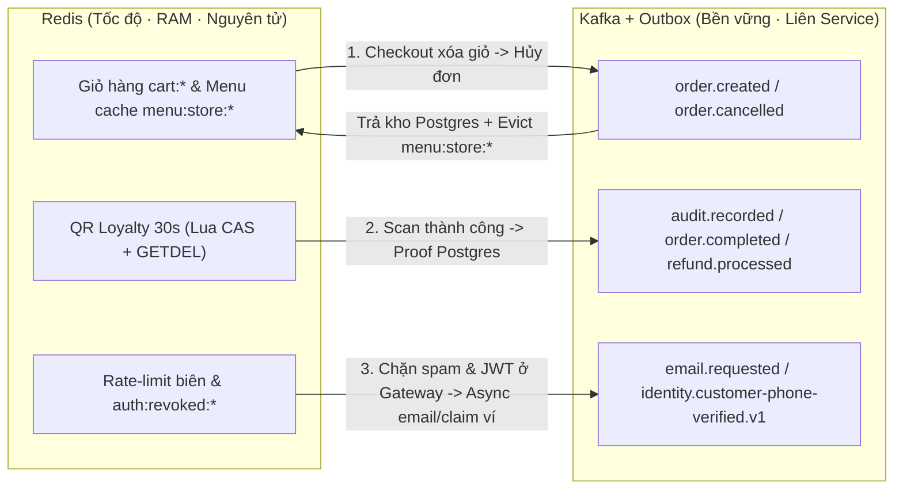

[← Mục lục tra cứu nhanh](./00-muc-luc.md)

# 07 — Combo Kafka + Redis trong Clucky làm được gì?

> **Trả lời nhanh 30 giây:** Trong Clucky, **Redis** đảm nhiệm tầng dữ liệu **nóng, tạm thời, mili-giây và nguyên tử** (giỏ hàng, cache menu, số gọi quầy, QR Loyalty 30s, danh sách đen thu hồi JWT, chặn spam ở biên), còn **Apache Kafka + Transactional Outbox** đảm nhiệm tầng sự kiện **bền vững, bất đồng bộ, fan-out nhiều service và kiểm toán** (vòng đời đơn, thanh toán 2 chiều, hoàn tiền, trả kho, tính điểm, báo cáo, email, audit). Hai công nghệ **bổ trợ lẫn nhau** giúp hệ thống vừa phản hồi nhanh ở quầy/web vừa giữ nhất quán dữ liệu liên service.

---

## 1. Triết lý phân vai: Redis vs Kafka (Nói 30 giây là Mentor hiểu)

| Tiêu chí | **Redis 7 (In-Memory RAM)** | **Apache Kafka 3.9 + Outbox (Durable Log)** |
|---|---|---|
| **Bản chất** | Kho lưu trữ key-value trên RAM, xử lý dưới mili-giây | Hệ thống truyền thông điệp lưu đĩa theo thứ tự, hỗ trợ đọc lại (replay) |
| **Đặc điểm dữ liệu** | Ngắn hạn (TTL tự xóa), thay đổi liên tục, hoặc cần kiểm tra cực nhanh trên mọi request | Sự kiện nghiệp vụ quan trọng đã chốt trong DB, **tuyệt đối không được mất** |
| **Cơ chế mạnh nhất** | `INCR`, `GETDEL`, **Lua Script** (CAS nguyên tử), kiểm tra O(1) ở Gateway | **Transactional Outbox** (`AT-LEAST-ONCE`), Consumer Group độc lập, Retry & **DLT** |
| **Clucky dùng cho gì?** | Giỏ hàng, Menu cache, Queue POS, QR Loyalty 30s, Thu hồi JWT, Rate-limit | Tạo/hủy/hoàn tất đơn, SePay 2 chiều, Hoàn tiền, Trả kho, Điểm/Voucher, Báo cáo, Email, Audit |
| **Clucky KHÔNG dùng cho gì?** | **Không** làm Pub/Sub broker, **không** dùng giữ tiền thanh toán hay idempotency đơn hàng | **Không** dùng làm cache đọc dữ liệu hay đếm rate-limit |

---

## 2. Toàn bộ 6 ứng dụng Redis THỰC TẾ trong Clucky

| # | Nghiệp vụ & Service | Key Pattern & Kiểu dữ liệu | TTL & Chính sách lỗi | Giá trị mang lại |
|---|---|---|---|---|
| 1 | **Giỏ hàng** (`cart-order-service`) | Hash `cart:{userId}` & `cart:guest:{sessionId}` | 7 ngày / 24 giờ (hardcode hằng số) | Giảm tải ghi cho Postgres, đồng bộ đa thiết bị, tự dọn giỏ bỏ dở |
| 2 | **Số gọi món POS** (`cart-order-service`) | String `queue:store:{storeId}:{yyyyMMdd}` (`INCR`) | 2 ngày (xoay vòng `1–999`, có mốc DB fallback) | Cấp số thứ tự `#001–#999` tức thì, không tranh chấp lock bảng đơn hàng |
| 3 | **Cache Thực đơn chi nhánh** (`catalog-store-service`) | String JSON `menu:store:{storeId}` & `menu:store:all` | 5 phút (`CatalogCacheService`, **fail-open** về DB) | Giảm query DB Catalog khi khách mở menu; tự xóa cache sau `afterCommit` khi kho/món đổi |
| 4 | **Live Loyalty QR & Voucher Throttle** (`promotion-loyalty-service`) | `loyalty:active:*`, `loyalty:session:*` (Hash), `loyalty:qr:*`, `loyalty:text:*`, `loyalty:throttle:*`, `clucky:voucher:attempt:*` | 30s (mã), 70s (lease), 90s / 1m (throttle 30 lần/phút) | Xoay mã 30s bằng **4 Lua script**, chống quét lặp bằng **`GETDEL`**, chặn dò mã tại quầy |
| 5 | **Thu hồi JWT tức thì** (`identity-service` ghi → `api-gateway` & 9 service đọc) | `auth:revoked:sid:{sid}`, `auth:revoked:user:{userId}`, `auth:revoked:user-ns:{userId}` | `refreshTtl + accessTtl + 1m` (~7 ngày 31p), **fail-closed** (`503`/`401`) | Đăng xuất / khóa tài khoản chặn token cũ **tức thì** ở biên Gateway mà không cần gọi DB Identity |
| 6 | **Rate-limit & Google Pending** (`api-gateway`, `identity-service`) | `rate-limit:branch-http:*`, `rate-limit:otp:*`, `rate-limit:google:*`, `auth:google:pending:{sha256}` | 1m / 5m / 10m (Lua `INCR + PEXPIRE`), **fail-closed** | Chống brute-force OTP (5 lần/5p), Google login (10/1p), branch API theo IP (30–60/1p) |

> **Cấu hình Redis triển khai (`deploy/backend/compose.yml`):** `redis:7-alpine`, bật `--appendonly yes` (AOF lưu đĩa), giới hạn `--maxmemory 192mb` và `--maxmemory-policy noeviction` để **không bao giờ tự xóa nhầm marker thu hồi JWT `auth:revoked:*`** khi đầy bộ nhớ.

---

## 3. Hạ tầng Apache Kafka: Outbox, Idempotency & DLT an toàn PII

### Cấu hình chống mất & chống loạn tin nhắn (`config-repo/application.yml`)
- **Broker:** `apache/kafka:3.9.0` chế độ KRaft, mặc định 3 partition.
- **Producer:** `acks = all` và `enable.idempotence = true` (đảm bảo broker đã ghi nhận đủ mới ACK, không trùng tin ở tầng network).
- **Consumer:** `enable-auto-commit = false`, `isolation.level = read_committed`, `AckMode.MANUAL_IMMEDIATE` (chỉ xác nhận offset **sau khi** DB transaction thành công; riêng `NotificationConsumer` đẩy `ack` vào `TransactionSynchronization.afterCommit()`).

### A. Transactional Outbox Pattern (11 bảng Outbox trên 8 Service)
Thay vì lưu DB xong rồi gọi thẳng `kafkaTemplate.send(...)` *(dễ mất sự kiện nếu Kafka sập đúng tích tắc sau khi DB commit)*, **8/9 business service** dùng **Transactional Outbox** (`Propagation.MANDATORY`):
1. Trong **cùng một DB Transaction** với thao tác nghiệp vụ (tạo đơn, duyệt hoàn tiền, nhận tiền...), hệ thống ghi bản ghi sự kiện vào bảng `*_outbox` (`order_service.outbox_events`, `payment_service.payment_outbox`, `catalog_service.catalog_event_outbox`, `shipping_service.mock_delivery_outbox`, ...).
2. Worker nền định kỳ (`2s`–`5s`, riêng Mock Shipping `500ms`) dùng `SELECT ... FOR UPDATE SKIP LOCKED` đọc bản ghi chưa gửi, gọi Kafka chờ **ACK đồng bộ** (`.get(timeout)`) rồi mới đánh dấu `published` *(đảm bảo gửi ít nhất 1 lần — **at-least-once**)*. *(Ngoại lệ duy nhất: `email.requested` gửi thẳng OTP và `OutboxProcessor` của Order dùng kết hợp `@TransactionalEventListener(AFTER_COMMIT)` + poll 5s).*

### B. Danh mục ~19 Kafka Topics trong Clucky

| Nhóm luồng | Topics chính | Producer → Consumer chính |
|---|---|---|
| **Vòng đời đơn** | `order.created`, `order.status-changed`, `order.completed`, `order.cancelled` | `cart-order-service` → `catalog-store`, `shipping`, `promotion-loyalty`, `payment`, `review-report`, `notification` |
| **Thanh toán 2 chiều** | `payment.received`, `order.payment-resolved`, `payment.confirmed`, `payment.failed` | `payment-service` ↔ `cart-order-service` → `review-report`, `notification` |
| **Hoàn tiền** | `refund.waiting-bank-details`, `refund.approved`, `refund.rejected`, `refund.processed` | `cart-order-service` → `promotion-loyalty` (clawback điểm), `notification` |
| **Giao mô phỏng** | `shipping.started`, `shipping.delivered`, `shipping.failed`, `shipping.resolved` | `shipping-service` → `cart-order-service` (`ShippingOrderProjection`) |
| **Bảo mật & Kho** | `email.requested`, `identity.branch-email`, `identity.customer-phone-verified.v1`, `inventory.low-stock`, `notification.email-failed`, `audit.recorded` | `identity`/`catalog`/`7 services` → `notification`, `promotion-loyalty` (nhận điểm SĐT guest), `audit-service` |

### C. Consumer Idempotency & Nguyên tắc "Kafka chỉ là Trigger"
Vì Outbox có thể gửi lại nếu rớt ACK, **mọi Consumer đều có chốt chống xử lý lặp**:
- Dùng bảng dedup + `INSERT ... ON CONFLICT DO NOTHING` theo `event_id` hoặc khóa nghiệp vụ: `payment_service.processed_events`, `review_report_service.processed_events`, `order_service.payment_decisions` / `collection_decisions` / `mock_delivery_receipts`, `catalog_service.order_stock_ledger(order_id)`, `shipping_service.order_created_receipts`, `notification_service` (`operation_key`), `audit_service.audit_logs(event_id)`.
- **Kỹ thuật nâng cao ở `promotion-loyalty-service`:** `LoyaltyEvents` & `LoyaltyRefundEvents` coi Kafka **chỉ là tín hiệu báo thức (Trigger)** — khi nhận event sẽ gọi ngược REST `GET /internal/loyalty/orders/{id}` để đọc trạng thái mới nhất từ `cart-order-service` (SSOT) trước khi cộng/trừ điểm, tránh xử lý sai khi event đến lệch thứ tự!

### D. Dead Letter Topic (`.DLT`) an toàn PII & Replay Tool
- **Retry & Quarantine (`DefaultErrorHandler`):** Lỗi tạm thời thử lại 3 lần (`backoff 1s`); lỗi sai định dạng/parse (`JsonProcessingException`, `IllegalArgumentException`...) đưa ngay vào `<topic>.DLT`.
- **Không rò rỉ dữ liệu cá nhân vào DLT:** Thay vì đẩy nguyên JSON chứa tên/SĐT/địa chỉ khách vào topic `.DLT`, Clucky đóng gói một **Quarantine Envelope** chỉ giữ metadata, `sha256` bản ghi gốc và danh sách trường số an toàn (`orderId`, `amount`, `storeId`...), header lỗi cố định `"Consumer processing failed"`. *(Lưu ý thẳng thắn: `catalog-store-service` và `identity-service` hiện chưa cấu hình DLT producer mà ném lỗi giữ offset để không mất dữ liệu).*
- **Công cụ phát lại (`scripts/replay-kafka-dlt.py`):** Cho phép replay từng bản ghi với kiểm tra bắt buộc `--expected-sha256`, `--reason`, `--source-record` (phải khớp đúng hash với bằng chứng DLT), và ghi nhật ký audit có `fsync` vào `secrets/kafka-replay-audit.jsonl`.

---

## 4. Combo Kafka + Redis trong Clucky phối hợp làm được gì? (4 Kịch bản thực tế)

1. **Kịch bản 1 — Giỏ hàng + Cache Menu kết hợp Saga Trả kho (`Order` ↔ `Catalog`):**
   - *Redis* giúp khách thêm món cực nhanh trên `cart:*` và xem thực đơn từ `menu:store:{storeId}` (5p) mà không đè nặng DB.
   - Khi chốt Checkout, `OrderService` xóa giỏ Redis và phát `order.created` (hoặc sau đó `order.cancelled`) qua *Kafka Outbox*.
   - Khi nhận `order.cancelled`, `Catalog` (`OrderStockConsumer`) trả lại số lượng vào Postgres **và lập tức xóa cache `menu:store:{storeId}` trong Redis sau `afterCommit()`**, đảm bảo khách hàng mở lại menu thấy ngay món vừa được hoàn tồn kho!
2. **Kịch bản 2 — Quét QR Loyalty 30s tại quầy đến Chốt điểm & Kiểm toán:**
   - *Redis* giải quyết bài toán thời gian thực tại quầy: xoay mã 30s bằng Lua CAS, chặn quét bừa 30 lần/phút, và tiêu thụ mã 1 lần duy nhất bằng `GETDEL` trong < 1ms.
   - Ngay sau đó, *Kafka* đẩy `audit.recorded` về `audit-service`, và khi đơn đi tới `order.completed` hay `refund.processed`, Kafka phối hợp chốt hoặc thu hồi điểm thưởng bền vững ở `promotion-loyalty-service`.
3. **Kịch bản 3 — Bảo vệ tài khoản, OTP & Claim ví điểm theo SĐT:**
   - *Redis* chặn spam OTP/Google/Branch API bằng Lua rate-limit ở biên và vô hiệu hóa JWT bị thu hồi trên cả Gateway + 9 services không cần chạm DB Identity.
   - *Kafka* đẩy luồng nặng ra nền: gửi email OTP (`email.requested`, `identity.branch-email`), thông báo khách xác minh SĐT (`identity.customer-phone-verified.v1` để `Loyalty` gộp ví tích điểm khách vãng lai tại quầy vào tài khoản), và ghi log bảo mật (`audit.recorded`).
4. **Kịch bản 4 — Tư duy chọn công cụ: Tại sao Tiền & Idempotency đơn KHÔNG dùng Redis mà dùng Postgres Outbox + Kafka?**
   - Vì dữ liệu đơn hàng và tiền chuyển khoản đòi hỏi tính **ACID** và dấu vết kiểm toán vĩnh viễn. Dùng Postgres + Outbox + Kafka đảm bảo không bao giờ mất đơn hay sai tiền nếu RAM Redis đầy (`noeviction`) hoặc restart.

---

## 5. Nếu Mentor hỏi: "Khi hệ thống Scale 10x, Combo Kafka + Redis mở rộng thêm gì?"

- **Đóng gói thao tác Giỏ Redis thành Lua Script:** Loại bỏ hoàn toàn race condition read-modify-write khi lưu lượng tăng cao.
- **Kafka Consumer Horizontal Scaling:** Hiện topic có 3 partitions — có thể tăng số partition & chạy nhiều replica mỗi service để xử lý song song theo `orderId` (ordering key).
- **Redis Debounce / Distributed Lock & Cache Invalidation:** Kết hợp sự kiện Kafka (thay đổi giá/tồn/khuyến mãi) để chủ động làm mới cache Redis đa tầng cho các màn hình Menu & Flash Sale.

---

## File code mở chứng minh ngay
- Redis Cart & Queue: `backend/cart-order-service/src/main/java/com/clucky/cartorderservice/cart/CartService.java`, `service/OrderService.java` (L1655–1683)
- Redis Menu Cache: `backend/catalog-store-service/src/main/java/com/clucky/catalogstoreservice/service/CatalogCacheService.java`
- Redis Live Loyalty & Lua: `backend/promotion-loyalty-service/src/main/java/com/clucky/promotionloyaltyservice/service/LiveLoyaltySessionService.java`
- Redis Revocation & Rate-limit: `backend/identity-service/src/main/java/com/clucky/identityservice/service/SessionRevocationService.java`, `OtpService.java`, `backend/api-gateway/src/main/java/com/clucky/apigateway/config/AccessTokenValidator.java`, `BranchChallengeRateLimitFilter.java`
- Kafka Config, Outbox, DLT & Replay: `config-repo/application.yml`, `backend/cart-order-service/src/main/java/com/clucky/cartorderservice/service/OutboxProcessor.java`, `config/KafkaConfig.java`, `scripts/replay-kafka-dlt.py`
