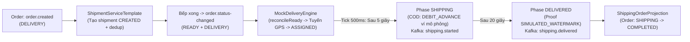

[← Mục lục tra cứu nhanh](./00-muc-luc.md)

# 09 — Vận chuyển Mô phỏng (Mock Delivery) & Mã QR Động Clucky Club

> **Trả lời nhanh 30 giây:** (1) Theo ranh giới MVP, Clucky tạo bản ghi giao hàng thật qua Kafka `order.created` và chạy **`MockDeliveryEngine`** trong `shipping-service` (tick **500ms**: chờ **5s** nhận món → **20s** giao xong có watermark) để test khép kín E2E; tiền shipper ứng cho đơn COD lưu riêng vào `merchantPaymentStatus = PAID_SIMULATED` nhằm **không làm sai sổ doanh thu thật hay cộng nhầm điểm thưởng**. (2) **QR Clucky Club** dùng kiến trúc **"Dynamic Live Loyalty Presence"** xoay mã mỗi **30 giây** bằng **4 Lua script**, tiêu thụ 1 lần bằng Redis **`GETDEL`**, tách quyền giữa **QR (tích + tiêu điểm)** và **Mã chữ `LY-...` (chỉ tích điểm)**, và ràng buộc bằng chứng quét `loyalty_scan_proofs` chống tráo đơn.

---

## Phần A — Vận chuyển Mô phỏng (`MockDeliveryEngine`) & Kế toán COD

### 1. Quy trình 4 bước khép kín (`shipping-service` ↔ `cart-order-service`)

1. **Tạo bản ghi shipment thật:** Khi `order.created` phát ra cho đơn `DELIVERY`, `ShipmentServiceTemplate.createFromOrder` khóa tư vấn `pg_advisory_xact_lock`, chống lặp qua `shipping_service.order_created_receipts` và tạo shipment (`CREATED`). *(Đơn `PICKUP` không tạo shipment).*
2. **Tiếp nhận đơn sẵn sàng (`OrderStatusChangedConsumer`):** Khi bếp bấm `READY`, `MockDeliveryEngine.acceptOrderStatus` kiểm điều kiện: VietQR phải `PAID`, COD phải `PENDING`, đơn 0đ phải `COLLECTED/NO_PAYMENT`, rồi đưa vào `mock_ready_orders`.
3. **Gán tuyến & Tài xế nhận món (5 giây):** `reconcileReady()` gọi `MockRouteProvider` tạo tuyến đường và lượt giao `Attempt #1` (`WAITING_RIDER`, shipment `ASSIGNED`). Vòng lặp `reconcileDeadlines()` (tick mặc định **500ms**) kiểm tra sau **5 giây** sẽ chuyển phase sang `SHIPPING`, đặt `due_at = now() + 20s`, phát Kafka **`shipping.started`** → `ShippingOrderProjection` đẩy Order sang `SHIPPING`.
4. **Giao xong & Tự hoàn tất (20 giây):** Khi đến hạn `due_at`, Engine tạo bằng chứng `SIMULATED_WATERMARK`, chuyển `DELIVERED`, phát **`shipping.delivered`** → `ShippingOrderProjection` (chống lặp qua `order_service.mock_delivery_receipts`) chốt Order sang **`COMPLETED`**. *(Nhân viên tại quầy bị chặn `409` nếu cố bấm hoàn tất tay đơn `DELIVERY`).*

### 2. Ví ứng COD mô phỏng & Tại sao không tính vào doanh thu / Loyalty?
- **Bảng ví thật trong DB:** **`shipping_service.mock_wallet_ledger`** (khóa giao dịch bằng `pg_advisory_xact_lock(hashtext('clucky-mock-wallet'))`). Với đơn COD `PENDING`, khi nhận hàng hệ thống ghi `DEBIT_ADVANCE` bằng số tiền hàng (`totalAmount - shippingFee`); nếu trả hàng về quán ghi `CREDIT_RETURN`. *(Đơn VietQR đã `PAID` không trừ ví tài xế).*
- **Chiếu sang `Order.merchantPaymentStatus` (`V26`):**
  - Giao nhận mô phỏng → `merchantPaymentStatus = PAID_SIMULATED`.
  - Trả món hoàn ứng → `merchantPaymentStatus = ADVANCE_RETURNED`.
  - **Quan trọng:** `Order.paymentStatus` **VẪN GIỮ `PENDING`**! Giao diện React (`displayPaymentStatus` ở `order-fulfillment.ts`) hiển thị nhãn ứng mô phỏng cho thu ngân dễ nhìn, nhưng các công thức **Sổ quỹ thu thật (`PAID`/`COLLECTED`)**, **Doanh thu (`order.completed` đủ `settlementEligible`)** và **Điểm thưởng Loyalty (`LoyaltyOrderController`)** đều **tuyệt đối không** tính `PAID_SIMULATED` như tiền khách đã thu thật.
- **Can thiệp sự cố (`MockDeliveryController`):** Hỗ trợ mô phỏng `fail` (giữ Order `SHIPPING` chờ xử lý), `retry` (tạo Attempt mới cho Manager/Admin), `returned` (trả ví `CREDIT_RETURN` → `ADVANCE_RETURNED`), và `close` (đưa Order về `DELIVERY_FAILED`).

---

## Phần B — Cơ chế Mã QR Động Clucky Club (`LiveLoyaltySessionService`)

### 1. Bài toán bảo mật F&B tại quầy
Nếu dùng mã thẻ tĩnh hoặc số điện thoại để tích/tiêu điểm: người đứng sau có thể nhìn trộm, hoặc khách chụp màn hình gửi cho bạn đi quét tiêu hết điểm từ xa (**Replay Attack**). Clucky giải quyết bằng **"Dynamic Live Loyalty Presence"** — mã chỉ sống khi khách đang mở trang `/loyalty` và tự xoay mỗi **30 giây**.

### 2. Tách biệt quyền lực giữa 2 loại mã trên giao diện

| Đặc điểm | **Mã QR Vector (`CLUCKY:LOYALTY:V1:<32B>`)** | **Mã chữ dự phòng (`LY-<12 ký tự>`)** |
|---|---|---|
| **Độ mạnh mật mã** | **256 bits entropy** (`SecureRandom`) | **> 80 bits entropy** (Base64 URL-safe in hoa) |
| **Cách dùng tại POS** | Máy quét mã vạch / Camera quét | Thu ngân gõ tay khi hỏng máy quét |
| **Quyền TÍCH ĐIỂM (Earn)** | **CÓ** | **CÓ** |
| **Quyền TRỪ ĐIỂM (Redeem)** | **CÓ** | **KHÔNG ĐƯỢC PHÉP** *(ngăn nhìn trộm rút điểm)* |
| **Cơ chế tiêu thụ** | **Xóa ngay sau 1 lần quét (`GETDEL`)** | Tra cứu theo `generation` trong chu kỳ 30s |

### 3. Cơ chế đồng bộ Frontend Next.js (`live-loyalty-code.tsx`)
1. **Chống lệch giờ điện thoại (Anti-Clock Skew):** Tính `timeOffset = Date.parse(serverTime) - Date.now()` khi nhận phản hồi từ `/api/loyalty/live-session/open`, rồi mới tính giây còn lại (tick thanh tiến trình mỗi **250ms**).
2. **Ẩn mã không rò rỉ (Zero-Leakage Expire):** Đúng giây `remaining === 0`, lập tức gọi `setCurrent(null)` xóa SVG khỏi DOM trước khi gọi `rotate` xin cặp mã mới.
3. **Duy trì & Đóng phiên tức thì:** Bắn `heartbeat` mỗi **3 giây**; khi chuyển trang/đăng xuất/tắt tab (`pagehide`) gửi `close` bằng `fetch(..., { keepalive: true })`.

### 4. Thiết kế Redis nguyên tử & Chống gian lận Backend (`LiveLoyaltySessionService`)
Toàn bộ mã tra cứu lưu trong Redis dưới dạng băm **SHA-256** (`loyalty:text:{sha256}`, `loyalty:qr:{sha256}` TTL **30s**), cùng Session Hash `loyalty:session:{sessionId}` (TTL **70s**) và khóa 1 tab duy nhất `loyalty:active:{customerId}`:

- **4 Lua Script đảm bảo tính nguyên tử:**
  1. `OPEN_SCRIPT`: Mở tab mới → tự động `DEL` phiên của tab cũ (`Single Active Tab`).
  2. `CLOSE_SCRIPT`: Compare-and-delete (chỉ xóa nếu đúng `sessionId` đang active).
  3. `HEARTBEAT_SCRIPT`: Kiểm tra đúng `sessionId` đang active thì gia hạn `PEXPIRE` **70s**.
  4. `ROTATE_SCRIPT`: Compare-And-Swap (CAS) theo `generation` + `expiresAt`, nâng thế hệ mã mới và gia hạn 70s.
- **Chống quét lặp bằng `GETDEL`:** API `POST /api/loyalty/counter/loyalty/scan` dùng lệnh Redis nguyên tử `getAndDelete(credentialKey("qr", qrToken))`. Hai máy quét cùng lúc chỉ 1 máy lấy được mã, máy thứ hai nhận ngay lỗi `ConflictException`.
- **Khóa bằng chứng quét vào đúng đơn nháp (`loyalty_scan_proofs`):** Sau khi `GETDEL` thành công, lưu SHA-256 `proof_hash` vào bảng `promotion_service.loyalty_scan_proofs` gắn cứng **`(customer_id, session_id, staff_id, store_id, draft_hash, expires_at = 30s)`** → ngăn thu ngân quét QR của khách A nhưng lại lén áp giảm giá sang đơn của khách B! *(Tiêu thụ proof có `FOR UPDATE` & `consumed_order_id UNIQUE`)*.
- **Giới hạn tốc độ quét (Rate Limiting):** Key `loyalty:throttle:{scan|lookup}:{staffId}:{storeId}:{epochMinute}` (TTL 90s), giới hạn tối đa **30 lần/phút** (`429 TOO_MANY_REQUESTS`).

---

## File code mở chứng minh ngay
- Mock Delivery & Ví COD: `backend/shipping-service/src/main/java/com/clucky/shippingservice/service/MockDeliveryEngine.java`, `ShipmentServiceTemplate.java`, `controller/MockDeliveryController.java`, migration `V9__mock_delivery_attempts.sql`
- Chiếu trạng thái sang Order & UI: `backend/cart-order-service/src/main/java/com/clucky/cartorderservice/service/ShippingOrderProjection.java`, `frontend/react/src/lib/order-fulfillment.ts` (L4–10)
- Live Loyalty QR (BE + FE): `backend/promotion-loyalty-service/src/main/java/com/clucky/promotionloyaltyservice/service/LiveLoyaltySessionService.java`, `controller/LiveLoyaltyController.java`, `frontend/nextjs/components/loyalty/live-loyalty-code.tsx`
