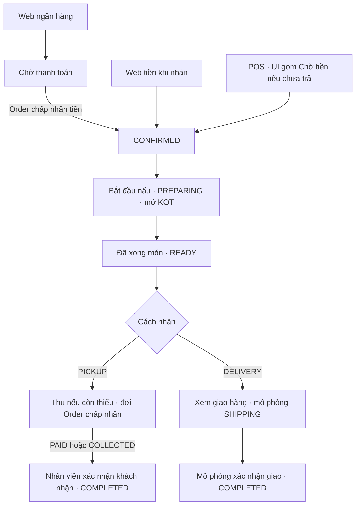

# Clucky khung thuyết trình luồng đặt hàng

Cập nhật ngày 19/11/2026 theo commit `18c3ea4`. Khung để tự diễn đạt theo mạch **khách đặt → staff và bếp → nhận món → quản lý ngày → phần tâm đắc**. Chi tiết kỹ thuật nằm trong bản Word cùng ngày.

## 1 Xác định đúng một đơn hàng

- **Nguồn tạo** — `WEB` khách đặt, `COUNTER` nhân viên nhập POS.
- **Cách nhận** — `DELIVERY` giao tận nơi, `PICKUP` nhận tại quầy. POS thêm Ăn tại chỗ/Mang đi.
- **Cách trả** — tiền mặt, ngân hàng, hoặc kết hợp ở POS.
- **Tiến độ và tiền** — `status` là món tới đâu, `paymentStatus` là tiền đã được chấp nhận chưa.

“Offline” trong cách kể là đặt trước tự lấy. Dữ liệu vẫn `WEB + PICKUP`. Tiền mặt tự lấy dùng mã cũ `COD` trong request, khi trình bày gọi tiền mặt tại quầy.

## 2 Khách chọn món và giỏ Redis

**Chọn chi nhánh/món → thêm giỏ → checkout → cách nhận và thanh toán → Đặt hàng ngay → chi tiết đơn.**

| Điểm nhấn | Hành vi hiện tại |
|---|---|
| Giỏ guest | Redis Hash `cart:guest:{sessionId}`, hạn **24 giờ**. Trình duyệt giữ guest ID. |
| Giỏ tài khoản | `cart:{userId}`, hạn **7 ngày**. Đăng nhập có bước gộp giỏ guest. |
| Khi nào gia hạn | Thêm/sửa số lượng dương đặt lại TTL. **Chỉ xem giỏ hoặc xóa riêng một món không gia hạn.** |
| Món giống nhau | Cùng ID và cấu hình option/topping/combo thì cộng số lượng theo `itemKey`. |
| Giá và tồn | Giỏ chưa giữ tồn/khóa giá. Backend xác minh lại khi preview và đặt. |

Ví dụ thêm giỏ guest lúc 10 giờ thứ Hai. Chỉ xem lúc 9 giờ thứ Ba vẫn hết hạn lúc 10 giờ. Nếu sửa món lúc 9 giờ thì hạn thành 9 giờ thứ Tư. Cấu hình chung có TTL nhưng CartService hiện dùng hằng 24h/7d.

Backend hỏi Catalog về món/giá, Shipping về phí/phạm vi, Loyalty về voucher/điểm. Sau lưu nháp `PENDING_STOCK`, giữ tồn chi nhánh rồi mới hoàn tất đơn. Giá mới lệch tổng khách vừa thấy có thể trả 409.

## 3 Các nhánh nhận món và thanh toán

Mỗi cặp dưới đây là **trạng thái đơn / trạng thái tiền trên Order** sau khi tạo thành công.

| Nhánh | Ban đầu | Chuyển tiếp |
|---|---|---|
| Web ngân hàng, giao hoặc tự lấy | `PENDING_PAYMENT / PENDING` | Khớp tiền và Order chấp nhận → `CONFIRMED / PAID`, rồi làm món. |
| Web giao COD | `CONFIRMED / PENDING` | Làm món trước, giao mô phỏng. Tiền ứng của quán lưu riêng. |
| Web tự lấy tiền mặt | `CONFIRMED / PENDING` | Làm món trước, thu tại quầy rồi xác nhận khách nhận. |
| POS tiền mặt | `CONFIRMED / PENDING` | Thu ngay sau tạo hoặc thu sau. Order chấp nhận → `COLLECTED`. |
| POS ngân hàng/kết hợp | `CONFIRMED / PENDING` | Mở phiên QR. Được chấp nhận → `PAID` hoặc `COLLECTED` với kết hợp. |

**Code mới cần nhấn mạnh**

POS còn `PENDING` được UI gom vào **Chờ tiền**, dù backend có thể `CONFIRMED`, `PREPARING` hoặc `READY`. Backend vẫn cho bắt đầu nấu từ `CONFIRMED` theo bảng chuyển. Khi tiền được chấp nhận, đơn quay về nhóm theo tiến độ. Vì vậy tab Chờ tiền không luôn đồng nghĩa `status=PENDING_PAYMENT`.

## 4 Gộp đoạn làm món và tách bước cuối

- Khách thấy **Đã xác nhận → Chế biến → Chờ khách đến lấy** hoặc **Sẵn sàng giao → Đang giao hàng**.
- Nhân viên dùng **Bắt đầu nấu → Đã xong món**. Tự lấy còn thiếu tiền có **Thu tiền quầy**, đã trả có **Xác nhận khách đã nhận**. Ăn tại chỗ có nhãn nhận món tại quầy riêng.
- **Chốt bàn giao PICKUP** — phải `READY` và tiền `PAID/COLLECTED`. Gửi hoàn tất sớm bị 409.
- Tổng 0 dùng `COLLECTED + NO_PAYMENT` để bỏ qua khoản thu.

**POS** mở Nhập đơn nhanh/F1. Tạo đơn và thu là hai yêu cầu. Thu lỗi sau tạo thì tìm lại đơn để thu tiếp. Trước khi có hoạt động thu, staff có thể đổi tiền mặt/ngân hàng/kết hợp. Sau claim hoặc phiên QR, backend chặn đổi phương thức.

**Bill và bếp** — biên lai tiền mặt có tổng, tiền nhận/thối, thu ngân. KOT có món, số lượng, tùy chọn và ghi chú, mở khi bắt đầu nấu. In K80 hiện mô phỏng. Receipt trả 201 có thể còn collection PENDING, cần đợi Order chấp nhận.

**Ngân hàng** — QR có mã tham chiếu riêng. SePay báo giao dịch, Payment đối soát và Order kiểm lại đơn trước khi ghi tiền. Thiếu tiền vẫn chờ, lặp ID không cộng lại, sai thông tin cần đối soát.

**Delivery** — MVP tạo shipment. Local bật mô phỏng thì READY lấy tuyến, giả lập nhận/giao và lưu bằng chứng mẫu. COD có `merchantPaymentStatus=PAID_SIMULATED` khi shipper ứng cho quán, còn `paymentStatus` có thể PENDING. Đây chưa là bằng chứng khách thực trả tiền. Trả món có thể thành `ADVANCE_RETURNED`.

## 5 Quản lý ngày và tích hợp

| Phần | Điều cần nhớ |
|---|---|
| Danh sách và Excel | Staff theo ngày tạo/chi nhánh. Manager chi nhánh mình, Admin hệ thống. Excel theo tập đã tải/lọc, Admin có phân trang. |
| Sổ Quỹ & Két Ca Trực | Payment tổng theo ngày Việt Nam/store, tiền mặt và ngân hàng đủ điều kiện. Hiện chưa nối shiftId/mở đóng ca. Ngày đơn và ngày tiền có thể khác. |
| Tồn chi nhánh | Giảm khi reserve sau nháp. Ledger theo orderId chống trừ lặp, hủy bù theo snapshot. |
| Voucher và điểm | Kiểm/giữ khi đặt. Hoàn thành đủ điều kiện mới chốt dùng/cộng EARN, hủy nhả. COD chỉ ứng mô phỏng không tự nhận thưởng như đơn thu thật. |
| Đánh giá | Đúng chủ, COMPLETED, món thuộc đơn và chưa trùng. |
| Đồng bộ | API quyết định ghi, UI đọc response/polling. Chi tiết khách khoảng 5 giây, các nguồn QR/tracking/báo cáo có nhịp riêng. |

## 6 Phần tâm đắc

**Khó ở đâu** — cùng ngân hàng nhưng web chờ tiền trước bếp, POS có nhóm UI khác. Thu, chế biến và giao là các mốc riêng. Nhiều người thao tác và nhiều service gửi kết quả có thể tới lệch thời điểm.

**Đã làm gì** — [Tôi xác nhận phần đóng góp này] phân nhánh đơn, chốt chuyển bước, kết nối kết quả tiền/giao và cập nhật UI. Điền đúng hàm/PR mình viết và phần phối hợp module khác.

**Giải quyết ra sao**

- `createOrder/createCounterOrder` chọn trạng thái ban đầu.
- `updateStatus` khóa dòng, kiểm chi nhánh, bước, tiền và version nếu có.
- `claimCounterPayment` phối hợp khóa phương thức khi bắt đầu thu POS.
- `ShippingOrderProjection` lưu tiến độ và tiền ứng mô phỏng, UI đọc lại qua API.

**Một ví dụ để chứng minh** — đơn web tự lấy tiền mặt ở `READY/PENDING`, gửi hoàn tất bị 409. Sau khoản thu được chấp nhận thành COLLECTED, xác nhận khách nhận thành công. Với POS, mở QR rồi thử đổi cách trả cho thấy chốt chống đổi khi đang thu.

## 7 Khi mentor hỏi sâu

- **Bấm hai lần** — key/hash và DB claim replay, nhưng web API còn cho bỏ key.
- **Hai nhân viên** — khóa dòng/version. Staff có gửi version, một số đường manager còn chưa gửi.
- **Lỗi sau giữ tồn** — rollback DB Order, nhả/bù theo service và job, có thể trễ.
- **Giỏ có an toàn cập nhật đồng thời tuyệt đối** — chưa thấy chuỗi Redis dùng Lua hoặc transaction toàn bộ.
- **Phần còn thiếu** — giao/máy in thật, phiên két theo ca, chọn giờ lấy trên checkout. Tự kiểm thêm tổng tiền mặt lẻ.

Mở code ở repo khi cần.

1. [CartService và TTL](F:/OJT/Clucky/backend/cart-order-service/src/main/java/com/clucky/cartorderservice/cart/CartService.java)
2. [OrderService tạo đơn và chuyển bước](F:/OJT/Clucky/backend/cart-order-service/src/main/java/com/clucky/cartorderservice/service/OrderService.java)
3. [OrderPaymentService và claim thu POS](F:/OJT/Clucky/backend/cart-order-service/src/main/java/com/clucky/cartorderservice/service/OrderPaymentService.java)
4. [StaffOrdersPage và cách gom Chờ tiền](F:/OJT/Clucky/frontend/react/src/pages/Staff/StaffOrdersPage.tsx)
5. [ShippingOrderProjection và COD mô phỏng](F:/OJT/Clucky/backend/cart-order-service/src/main/java/com/clucky/cartorderservice/service/ShippingOrderProjection.java)

Các luồng trên dựa trên khảo sát code. Kiểm thử chức năng do người trình bày tự thực hiện.

